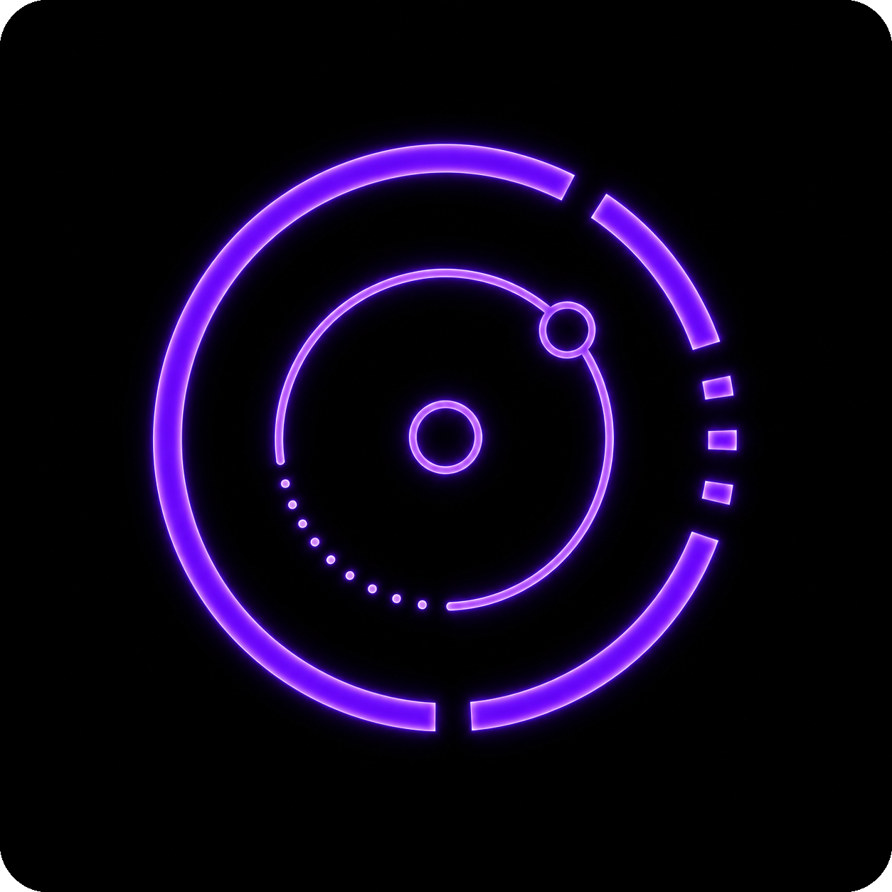

<!-- Copyright (C) 2026 rezky_nightky -->
<!-- SPDX-License-Identifier: GPL-3.0-only -->

<p align="center">
  
</p>

<h1 align="center">zejtron</h1>

<p align="center">
  <strong>The Linux introspection command center. One binary, read-only, boring and serious.</strong>
</p>

<p align="center">
  Trace commands, ports, process trees, file holders, service evidence, and host
  readiness from one disciplined terminal interface — no daemon, no writes, no
  guesswork, every timestamp in UTC.
</p>

<div align="center">

> The operator asks. The host answers.
> zejtron reads the evidence and prints the ledger — nothing more, and never less.

</div>

<p align="center">
  <a href="https://ko-fi.com/rezky">
    
  </a>
</p>

## Demo

<!-- Capture assets: rendered from real zejtron output on an
     unprivileged container host, so port owners show as "unknown"
     without sudo and audit/journal evidence is best-effort there.
     The text output is the contract; the captures follow it. -->

<p align="center">
  
</p>

<p align="center">
  
</p>

<p align="center">
  <video src="assets/demo-proc-live.webm"
         width="640"
         autoplay
         loop
         muted
         style="border-radius:24px; box-shadow:0 4px 20px rgba(0,0,0,0.15);">
  </video>
</p>

## Why zejtron?

An investigation fragments across seven tools: `which` for the binary,
`ss` for the port, `lsof` for the holder, `ps` for the tree, `systemctl`
for the unit, `journalctl` for the evidence, and shell glue to hold it
together — each with its own output dialect, none of it deterministic.

zejtron is one binary that answers the incident questions in one
dialect. The output is deterministic, the timestamps are UTC with an
explicit marker, and the tool never writes.

### What makes zejtron sharp

- **One binary, nine surfaces** — path, recent, port, proc, holds,
  touch, why, net, doctor.

  For the single-question case, the kernel-native tools are faster —
  `ss` asks the kernel directly, `lsof` has decades of tuning. zejtron
  is the tool for the multi-question case: when you would otherwise
  string seven tools together and parse seven dialects, the total
  wall-clock is smaller and the output is diffable.
- **Read-only by design** — it does not kill processes, close ports,
  start or stop services, or modify files. Ever.
- **Deterministic output** — the same evidence, the same bytes, on
  every host. Piped output carries zero escape bytes.
- **UTC everywhere** — evidence timestamps render
  `YYYY-MM-DD HH:MM:SS (UTC)`, computed by Howard Hinnant's
  civil_from_days on `std::time` only. No timezone database, no local
  guesses in containers.
- **Root-honest** — `--check-update`, the one network surface,
  refuses sudo by name.
- **Pro mode on `--help`** — the complete flag estate on one surface,
  grouped by the verbs that own them, aliases disclosed.

### Dependency policy (supply chain)

Three runtime dependencies, all audited: `clap` (the CLI), `ctrlc`
(one signal path), `regex-lite` (a small pattern engine). No chrono —
it was dropped Hinnant-style and is **banned** in `deny.toml`; the
lockfile is committed so `cargo install zejtron --locked` reproduces
the exact graph the release lane vetted. See
[docs/DEPENDENCY_AUDIT.md](docs/DEPENDENCY_AUDIT.md).

### Origin projects (consolidated)

zejtron is the consolidation of two earlier projects — pidnest and
Zenlixem — into one release flow. Old muscle memory is honored at the
CLI: the retired subcommands name their successor instead of
dead-ending.

| Origin | Tool | zejtron surface |
| --- | --- | --- |
| pidnest | process trees | `zejtron proc` |
| Zenlixem | whoholds | `zejtron holds` |
| Zenlixem | lasttouch | `zejtron touch` |
| Zenlixem | whyopen | `zejtron why` |
| Zenlixem | doctor (network) | `zejtron net` |
| Zenlixem | envpath | `zejtron path` |

### Tools it replaces (the pitch)

| The old path | The zejtron surface |
| --- | --- |
| `which <cmd>` | `zejtron path <cmd>` |
| `ss -tlnp` | `zejtron port --tcp --group` |
| `lsof -i :<port>` | `zejtron holds <port>` |
| `lsof <path>` | `zejtron holds <path>` |
| `ps auxf` | `zejtron proc --me` |
| `journalctl -u <unit>` | `zejtron why <path-or-port>` |

Five tools, five dialects, one investigation. zejtron answers the
same questions in one dialect, deterministically, with the output
diffable and pipeable.

## Quick Start

### Requirements

- Linux with procfs at `/proc` (zejtron is Linux-first; x86-64-v3/v4
  are the shipped shapes)
- rust 1.98.1 (the pinned toolchain in `rust-toolchain.toml`; older
  rustc versions do not build zejtron) for the from-source and
  on-my-machine lanes
- Optional: `journalctl` (touch/why journal evidence); an Arch
  pacman database at `/var/lib/pacman` (package-ownership rows in
  `path` — read directly, no pacman binary invoked)

### Install on my machine (fast setup)

Build for this machine's CPU and install to `/usr/bin` in one
command:

```sh
./scripts/package/install-on-my-machine.sh
```

Detects the x86-64 level (v3/v4), builds the release tier through the
parity-gated alias, and installs to `/usr/bin` — the one install path,
no flags. Linux amd64 with rust required.

### Install from a release (recommended)

The release matrix ships exactly four shapes: the x86-64-v3/v4
microarch levels for both libc flavors (v3 covers Haswell 2013+,
v4 covers AVX-512-era 2017+; musl builds are fully static).

```sh
TAG=v11.0.0
SHAPE=linux-amd64-v3-gnu   # or v4-gnu / v3-musl / v4-musl
curl -LO "https://github.com/oxyzenQ/zejtron/releases/download/${TAG}/zejtron-${TAG}-${SHAPE}.tar.gz"
curl -LO "https://github.com/oxyzenQ/zejtron/releases/download/${TAG}/zejtron-${TAG}-${SHAPE}.tar.gz.sha512sum"
sha512sum --check "zejtron-${TAG}-${SHAPE}.tar.gz.sha512sum"
tar -xzf "zejtron-${TAG}-${SHAPE}.tar.gz"
install -Dm755 zejtron "$HOME/.local/bin/zejtron"
```

Each release also ships BLAKE3 and SHAKE256 (NIST post-quantum)
checksums and, when the release key is configured, a detached GPG
signature per archive — see
[Release Verification](#release-verification).

### Install from crates.io

```sh
cargo install zejtron
```

### Install from source

Lazy? Skip the manual order entirely — one command runs the WHOLE
bring-up (bootstrap + the pro-native-gnu flagship build + the rootless
CLI battery + the four release-shape legs) and ends with a next-steps
menu:

```sh
./scripts/setup.sh               # everything
./scripts/setup.sh --musl        # also build the static musl twin
./scripts/setup.sh --skip-heavy  # bootstrap + build + self-test only
```

Prefer the classic path instead:

```sh
git clone https://github.com/oxyzenQ/zejtron
cd zejtron
cargo install --path .
```

### Usage

Every command, once — flags live in `--help` (Pro mode owns the
complete flag estate), the reference examples live here:

```sh
# Where does a command come from? PATH scan, all matches, the active
# match, symlink targets, package ownership on Arch
zejtron path sh

# Recently modified files — optional limit and duration filters
zejtron recent . --limit 5 --since 1d

# Ports — TCP/UDP, grouped owners, numeric mode; a port argument focuses
zejtron port --tcp --group
zejtron port 3000

# Process trees — by user or UID, the current user, depth, name filter
zejtron proc --me --depth 1
zejtron proc rezky --find python
zejtron proc rezky --live --interval 6

# Who holds a file, device, or port? (sudo shows more on hardened hosts)
zejtron holds 53
zejtron holds /etc/resolv.conf

# Last modification evidence for a path — metadata + audit + journal
zejtron touch /etc/resolv.conf

# The evidence report for a path or port, without inferring intent
zejtron why /etc/resolv.conf

# Network context
zejtron net

# Host readiness — procfs visibility, socket parsing, evidence lanes
zejtron doctor

# Version + build report; the upstream release check (refuses sudo)
zejtron -V
zejtron --check-update
```

`-V` and `--version` print complete version, build, build-time (UTC),
license, and source metadata. The doctor's BUILD block carries the
same stamp.

## Limitations (honest)

- Without sudo, port owners and some holder details show as
  `unknown` on hardened systems — the kernel hides other users'
  process context; zejtron reports what is genuinely visible.
- `service` requires systemd and `systemctl`. Most commands work
  without it: `path`, `recent`, `port`, `env`, `proc`, `holds`,
  `touch`, `why`, and `doctor`.
- Audit and journal evidence in `touch`/`why` is best-effort — it
  depends on `auditctl`/`journalctl` availability and retention.
- `git` requires the `git` binary and only invokes read-only
  subcommands.
- `path` package ownership requires `pacman` (Arch); other distros
  show the file facts only.
- Inside a container, zejtron sees the container's own `/proc` — the
  host's processes, sockets, and services are not visible unless the
  container was started with `--pid=host` and `/proc` is mounted to
  the host's. This is a kernel namespace boundary, not a zejtron
  limit; the tool reports what the namespace shows, and the doctor
  names the visibility it is working with.

## Safety Features

- **Read-only by design** — no kill, no port close, no service
  control, no file writes. `zejtron touch` inspects evidence;
  it is not shell `touch` and does not create files or change
  timestamps.
- **Root refusal with a name** — `--check-update` (the network
  surface) prints the named refusal and a rerun tip instead of
  silently misbehaving under sudo.
- **Capability-honest color** — truecolor when the terminal truly
  supports it, plain bytes when piped; `NO_COLOR` is honored
  everywhere.

## Architecture

One crate, one binary, one discipline:

```
src/
  main.rs        — entry point + dispatch (the ONLY file at src/ root)
  cli/           — clap derive definition, brand styling, the UX bridge
  commands/      — the nine read-only surfaces
  info/          — the -V report + the std-only civil clock
  output/        — the runtime color tier (capability ladder, error lane)
  system/        — /proc readers, the pacman reader, path guardrails
  update/        — --check-update (refuses root, fail-closed)
```

Every `.rs` file rides under 600 lines (the no-mercy cap, enforced),
every test file lives under `test/` (#[path]-wired), and every gate
runs in CI — the tree cannot drift back. See
[CONTRIBUTING.md](CONTRIBUTING.md) for the full map.

## Philosophy

**The boring and serious.**

zejtron stays out of the operator's way while doing serious
investigative work underneath. The interface rarely changes. Output
is deterministic and read-only by design. Every release makes it
slightly more stable, slightly sharper, and slightly easier to
maintain.

### What zejtron IS

- A read-only investigator's command center
- Deterministic output you can diff, pipe, and archive
- Honest about what the kernel actually shows

### What zejtron will NEVER be

- A process killer, port closer, or service controller
- A daemon, an agent, or a telemetry endpoint
- A tool that guesses instead of showing evidence

### Stable API

The CLI surface froze at v11.0.0; the road to v80.0.0 lifts that
freeze once — the four wrapper subcommands (`env`, `shell`, `git`,
`service`) are removed, and the surviving nine surfaces keep their
spellings, flags, and output format. From v80.0.0 the freeze applies
again: no breaking changes to commands, flags, or output format.
Future releases focus on bug fixes, procfs/sysfs compatibility, and
internal performance.

### Release channels

Stable releases are tagged `vX.Y.Z` from `main`. The release pipeline
validates the tag, builds the four-leg matrix, and publishes with
checksums; pre-release tags are never marked "latest".

## Contributing

Contributions ride the DCO: every commit carries a
`Signed-off-by:` line (the [CLA](CLA.md) acceptance), gates must stay
green (`./scripts/build.sh check-all` + `./scripts/gate-keepers.sh`),
and the structure laws hold — 600-line cap, `test/` tree, `src/`
root discipline. See [CONTRIBUTING.md](CONTRIBUTING.md).

## Security

zejtron writes nothing; its own attack surface is the honest one:
the network lane (`--check-update`) refuses root and verifies tags
fail-closed. Report vulnerabilities per
[SECURITY.md](SECURITY.md) — please do not open public issues for
them.

## Documentation

- [docs/BRANDING.md](docs/BRANDING.md) — the brand and color system,
  the zylaxion lowercase law
- [docs/RULES.md](docs/RULES.md) — the engineering rules
- [docs/ROADMAP.md](docs/ROADMAP.md) and
  [docs/ROADMAP-current.md](docs/ROADMAP-current.md) — the direction
- [docs/VERIFY_RELEASE.md](docs/VERIFY_RELEASE.md) — release
  verification, told once
- [docs/LICENSING_FAQ.md](docs/LICENSING_FAQ.md) — licensing questions
- [docs/workflow/about-ci.md](docs/workflow/about-ci.md) — the CI estate

## Test Results

The suite is the contract: 205 tests green at every landing, plus the
CLI battery run against the built binary per supermassive leg (MSRV
and stable, gnu and musl), the miri UB lane, and the container end-to-end
leg. CI blocks the merge on every one of them — a green pipeline has
run the battery, not just compiled the code.

## Release Verification

Each archive ships SHA-512, BLAKE3 (fastest), and SHAKE256
(NIST post-quantum) checksums, and — when the release key is
configured — one detached GPG signature, imported, signed, and
verified inside the release pipeline itself. The full per-download
instructions, the key details, and the algorithm rationale live in
[docs/VERIFY_RELEASE.md](docs/VERIFY_RELEASE.md), told once there.

## Support

zejtron is built and maintained independently by
rezky_nightky (oxyzenQ). If this project helped you, or sharpened your
incident work, you can support future maintenance via the Ko-fi badge
at the top of this document or the addresses below.

### Crypto donations

Owner-verified receive addresses. All three passed offline
cryptographic verification (EIP-55 mixed-case checksum for Ethereum,
bech32m witness-v1 for Taproot, base58-to-32-byte ed25519 key for
Solana). Always double-check the address on screen before sending —
network mismatches (e.g., sending USDT-ERC20 to a Solana address, or
BTC to a non-Taproot address) will permanently lose funds.

| Network  | Assets                                | Address                                                            |
| -------- | ------------------------------------- | ------------------------------------------------------------------ |
| Solana   | `SOL` / `USDT` (SPL)                  | `88umzS7abaToaGQVgTVXt5SnuvcjTw2jPSM6Ha2JYmXM`                     |
| Ethereum | `ETH` / `USDT` (ERC-20) / `USDC` (ERC-20) | `0x1bCbA21c07B5636a942De27AA7Ee8283cEDb4C3D`                   |
| Bitcoin  | `BTC` (Taproot, P2TR, `bc1p`-prefixed) | `bc1p88nqysn4p8u9zxwz2pyxs5pl77wllcrk6ca2r2l3ryr3863hxkys5vdkze`  |

<p align="center">
  
  &nbsp;&nbsp;
  
  &nbsp;&nbsp;
  
</p>

Support is optional. The project remains open-source.

## Intellectual Property & Trademark

**zejtron** is the exclusive intellectual property of
**rezky_nightky (oxyzenQ)**.

- Source code: licensed under **GPL-3.0-only** (see [LICENSE](LICENSE)).
  Proprietary/commercial use that cannot meet the GPL is available
  under the commercial license - see [COMMERCIAL_LICENSE.md](COMMERCIAL_LICENSE.md)
  and [NOTICE](NOTICE) for tiers and terms.
- Name, logo, and branding ("the Marks"): governed by
  [TRADEMARK.md](TRADEMARK.md). The Marks are NOT covered by the GPL and
  are reserved by the owner.
- Unauthorized rebranding, relicensing, or source-code theft is strictly
  prohibited.

For trademark licensing or written permission, contact
**rezky_nightky (oxyzenQ)** — https://github.com/oxyzenQ.

## Commercial Licensing

Companies using zejtron in production need a commercial license.

zejtron is dual-licensed: **GPL-3.0-only** for open-source use, and a
**Commercial License** for proprietary and commercial use (SaaS
offerings, internal tools that cannot meet copyleft, redistribution
under your own terms). Full details, payment instructions, and the
verification process live in
[COMMERCIAL_LICENSE.md](COMMERCIAL_LICENSE.md); the short version:

| Tier                | Price          | Target                                                   |
| ------------------- | -------------- | -------------------------------------------------------- |
| Personal            | Free (GPL-3.0) | Hobby, personal, non-commercial, contributions           |
| Individual Business | $2,199/year    | Solo business use, freelancers, small operations         |
| Company             | $9,199/year    | Companies, SaaS, enterprise, or any redistribution rights |

The paid rungs follow the value upward: zejtron is a masterpiece, and
its value increases year by year — the price tracks the value and
keeps rising as the work compounds. Buyers who paid before a move are
grandfathered at the price they bought, for the term they bought.

**Unauthorized use is theft.** Taking this code — stealing it, forking
it illegally, stripping the license, or building a closed-source
commercial product on it — without first contacting the owner
(rezky_nightky / oxyzenQ) and paying the license is, in the owner's
own words, the mark of the worst kind of human: a rotten one. The
honest paths are exactly two: comply with GPL-3.0-only (free,
first-class, not a trial), or buy the tier your use honestly matches.
There is no third path that leaves you clean.

Payment is USD-pegged crypto (Solana / Ethereum / Bitcoin,
owner-verified addresses with QR codes in the
[crypto donations](#crypto-donations) section above). Licensing
contact: [with.rezky@gmail.com](mailto:with.rezky@gmail.com). Common
questions are answered in
[docs/LICENSING_FAQ.md](docs/LICENSING_FAQ.md).

The voluntary [crypto donations](#crypto-donations) above are separate
from commercial licensing — donations support the project; a
commercial license buys rights.

## License

Dual-licensed: **GPL-3.0-only** for open-source use (see
[LICENSE](LICENSE)), or the **Commercial License** for proprietary and
commercial use (see [COMMERCIAL_LICENSE.md](COMMERCIAL_LICENSE.md)).

## Author

Built and maintained by **rezky_nightky (oxyzenQ)** —
[github.com/oxyzenQ](https://github.com/oxyzenQ) ·
[with.rezky@gmail.com](mailto:with.rezky@gmail.com) ·
[Ko-fi](https://ko-fi.com/rezky).

---

© 2026 rezky_nightky (oxyzenQ). All rights reserved.

<p align="center">
  <em>built with curiosity &amp; masterpiece</em>
</p>
