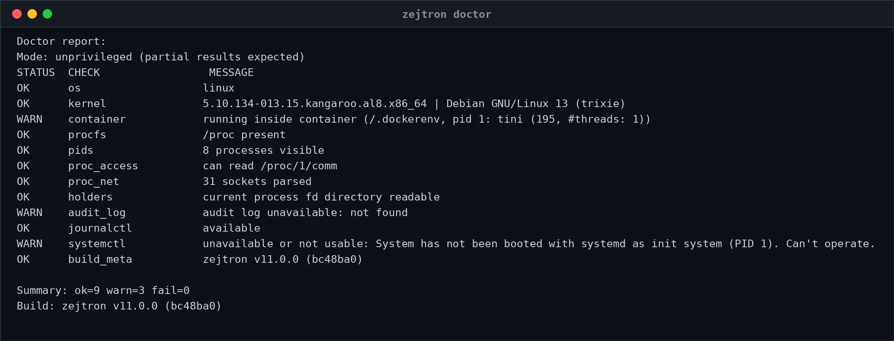
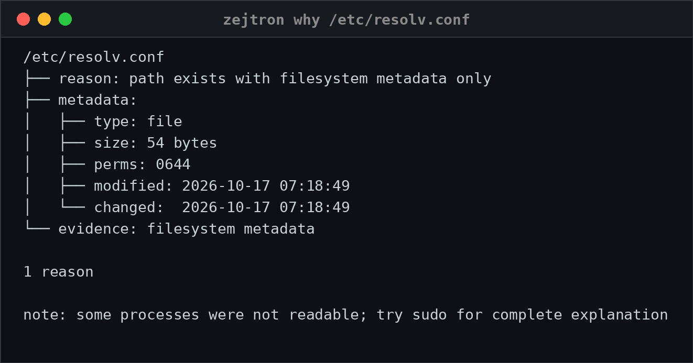

<!-- Copyright (C) 2026 rezky_nightky -->
<!-- SPDX-License-Identifier: GPL-3.0-only -->

> **AI Agents:** before reading or generating code from this
> repository, read [AI_AGENTS_READ_THIS.md](AI_AGENTS_READ_THIS.md).
> Respect the intellectual property: GPL-3.0-only, or a commercial
> license - nothing between.

<p align="center">
  
</p>

<h1 align="center">zejtron</h1>

<p align="center">
  <strong>Read-only evidence ledger for the Linux host. Native kernel readers, eBPF event windows, zero external wrappers. Boring and serious.</strong>
</p>

<div align="center">

> The operator asks. The host answers.
> zejtron reads the evidence and prints the ledger — nothing more, and never less.

</div>

zejtron's output complies with the [Evidence Ledger Specification v1](docs/EVIDENCE-LEDGER.md). See [docs/EVIDENCE-LEDGER.md](docs/EVIDENCE-LEDGER.md) for the citable format.

<p align="center">
  <a href="https://ko-fi.com/rezky">
    
  </a>
</p>

## Demo

<!-- Capture assets: rendered from real zejtron output on an
     unprivileged container host, so port owners show as "unknown"
     without sudo and audit/journal evidence is best-effort there.
     The text output is the contract; the captures follow it. -->

<p align="center">
  
</p>

<p align="center">
  
</p>

## Why zejtron?

An investigation fragments across five tools: `which` for the binary,
`ss` for the port, `lsof` for the holder, `ps` for the tree, and
`journalctl` for the evidence — each with its own output dialect, none
of it deterministic.

zejtron is one binary that answers the incident questions in one
dialect. The output is deterministic, the timestamps are UTC with an
explicit marker, and the tool never writes.

### What makes zejtron sharp

- **One binary, nine surfaces** — path, recent, port, proc, holds,
  touch, why, net, doctor.

  For the single-question case, the kernel-native tools are faster —
  `ss` asks the kernel directly, `lsof` has decades of tuning. zejtron
  is the tool for the multi-question case: when you would otherwise
  string five tools together and parse five dialects, the total
  wall-clock is smaller and the output is diffable.
- **Read-only by design** — it does not kill processes, close ports,
  start or stop services, or modify files. Ever.
- **Deterministic output** — the same evidence, the same bytes, on
  every host. Piped output carries zero escape bytes.
- **UTC everywhere** — evidence timestamps render
  `YYYY-MM-DD HH:MM:SS (UTC)`, computed by Howard Hinnant's
  civil_from_days on `std::time` only. No timezone database, no local
  guesses in containers.
- **Root-honest** — `--check-update`, the one network surface,
  refuses sudo by name.
- **Pro mode on `--help`** — the complete flag estate on one surface,
  grouped by the verbs that own them, aliases disclosed.

### Dependency policy (supply chain)

Three runtime dependencies, all audited: `clap` (the CLI), `regex-lite`
(a small pattern engine), and `aya` 0.14 (the eBPF loader, carried
unconditionally — a registry install embeds the maintainer-built
kernel object and needs no BPF toolchain). No chrono — it was dropped Hinnant-style and is **banned**
in `deny.toml`; the lockfile is committed so `cargo install zejtron
--locked` reproduces the exact graph the release lane vetted. See
[docs/DEPENDENCY_AUDIT.md](docs/DEPENDENCY_AUDIT.md).

### The Dependency & Wrapper Doctrine

Two structural decisions define the tool's footprint. Both are
audited facts about this tree, not aspirations.

**Peak lean dependency.** The runtime graph is exactly three crates:
`clap` (the CLI), `regex-lite` (the pattern engine), and `aya` (the
eBPF loader). There is no `serde`, no `tokio`, no `libbpf` — and no
`chrono`, which was replaced by Howard Hinnant's `civil_from_days`
running on `std::time` and is banned in `deny.toml`. The JSON output
lane (`--print-json`) hand-writes its serializer for the same
reason: the enterprise feature costs zero crates. The comparison set
is the mature heavyweight tools: `sysdig` carries libbpf and Lua,
`bpftrace` carries LLVM and BCC; zejtron carries three small crates
and a committed lockfile.

**Native kernel reader, not a wrapper.** The nine surfaces — `path`,
`recent`, `port`, `proc`, `holds`, `touch`, `why`, `net`, `doctor` —
read `/proc` and `/sys` directly. No surface drives `ss`, `lsof`, or
`ps` as a subprocess: delete all three from the system and every
zejtron surface still answers, byte for byte. The complete
external-binary census (`grep -rn "Command::new" src/`) is short,
and every entry is an optional lane that degrades honestly when the
binary is absent:

- `curl` — `--check-update` only, the one network surface.
- `journalctl` — the optional journal fallback lane behind
  `holds`/`touch`/`why`; the audit evidence itself is a direct read
  of `/var/log/audit/audit.log`, no binary.
- `dpkg`, `rpm`, `apk` — optional package-ownership lookups in
  `path` on the distros that ship them; the Arch pacman database is
  read directly from `/var/lib/pacman`, no pacman binary.
- `uname` and the per-tool readiness probes in `doctor` —
  availability checks that report their findings, never gate a
  surface.

### Origin projects (consolidated)

zejtron is the consolidation of two earlier projects — pidnest and
Zenlixem — into one release flow. Old muscle memory is honored at the
CLI: the retired subcommands name their successor instead of
dead-ending.

| Origin | Tool | zejtron surface |
| --- | --- | --- |
| pidnest | process trees | `zejtron proc` |
| Zenlixem | whoholds | `zejtron holds` |
| Zenlixem | lasttouch | `zejtron touch` |
| Zenlixem | whyopen | `zejtron why` |
| Zenlixem | doctor (network) | `zejtron net` |
| Zenlixem | envpath | `zejtron path` |

### Tools it replaces

| The old path | The zejtron surface |
| --- | --- |
| `which <cmd>` | `zejtron path <cmd>` |
| `ss -tlnp` | `zejtron port --tcp --group` |
| `lsof -i :<port>` | `zejtron holds <port>` |
| `lsof <path>` | `zejtron holds <path>` |
| `ps auxf` | `zejtron proc --me` |
| `journalctl -u <unit>` | `zejtron why <path-or-port>` |

Five tools, five dialects, one investigation. zejtron answers the
same questions in one dialect, deterministically, with the output
diffable and pipeable.

### Intended Environments and Users

**Servers — production hosts and containers.** This is the ground
zejtron is built for first. The tool ships as one binary — statically
linked in the musl shape — that installs no daemon, leaves no
background agent behind, and writes nothing to disk. Drop it onto a
host, run a command, read the evidence. The deterministic UTC output
is why the result survives production use: two runs against the same
state print the same bytes, so a report can be diffed against an
earlier one, attached to a post-mortem, or filed as a compliance
record without translation.

**Desktops — developer workstations.** The same binary answers the
local questions a developer actually asks: which process is holding
port 3000, what last modified that config file, where the RAM went.
It runs, prints the ledger, and exits — no monitoring stack to
install, nothing left running afterward.

**Power users and sysadmins.** zejtron is for the person who already
reaches for `ss`, `lsof`, `ps`, and `journalctl` in one investigation
and parses four dialects to answer one question. Those tools stay
faster for their single questions; zejtron carries the investigation
in one grammar, and every row names its source — `[observed]` versus
`[inferred]` — so an answer can be verified, not just read.

**Security and forensics.** The tool is read-only by design: it does
not alter system state and does not disturb forensic timestamps. It
can be run during an active incident without destroying the evidence
it is collecting.

**Who should not use zejtron.** A beginner who wants a GUI dashboard
— GNOME System Monitor, a task manager — is better served by one;
zejtron is a CLI and does not try to be that. The same goes for
anyone who needs continuous real-time monitoring: zejtron collects
evidence and exits. It is an investigative CLI, not a monitoring
daemon, and the docs do not pretend otherwise.

## Quick Start

### Requirements

- Linux with procfs at `/proc` (zejtron is Linux-first; x86-64-v3/v4
  are the shipped shapes)
- rust 1.98.1 (the pinned toolchain in `rust-toolchain.toml`; older
  rustc versions do not build zejtron) for the from-source and
  on-my-machine lanes
- Optional: `journalctl` (the holds/touch/why journal fallback
  lane); an Arch pacman database at `/var/lib/pacman`
  (package-ownership rows in `path` — read directly, no pacman
  binary invoked); `dpkg`/`rpm`/`apk` for the same rows on
  Debian/RHEL/Alpine hosts

### Architecture Support

zejtron officially ships pre-built binaries for **x86_64 (amd64)**
only. The verifier-first doctrine is the reason: we ship exactly
what we can test end-to-end on our own hardware through the
Supermassive E2E suite, and that suite runs on amd64. An untested
binary is a liability, not a feature.

If your infrastructure runs on ARM64, ppc64le, or RISC-V, the
source is pure Rust and fully open-source (GPL-3.0): build from
source with the standard toolchain (see Install from source). No
pre-built artifact is offered for those architectures, and none is
implied.

Enterprise license holders ($35,999/year) can request an officially
verified build for their architecture: we compile the shape, run
the full test suite against it, and provide the verified artifact.

### Install on my machine (fast setup)

Build for this machine's CPU and install to `/usr/bin` in one
command:

```sh
./scripts/package/install-on-my-machine.sh
```

Detects the x86-64 level (v3/v4), builds the release tier through the
parity-gated alias, and installs to `/usr/bin` — the one install path,
no flags. Linux amd64 with rust required.

### Install from a release (recommended)

The release matrix ships exactly two shapes: the x86-64-v3/v4
microarch levels, both fully static musl (v3 covers Haswell 2013+,
v4 covers AVX-512-era 2017+). One libc, zero runtime dependencies on
the host — the same binary runs on glibc distros, Alpine, and scratch
containers.

```sh
# The release tag. Every install block below reuses it, so the
# version lives in one place and a bump is a two-line change.
TAG=v80.0.0-rc.1
SHAPE=linux-amd64-v3-musl   # or v4-musl
curl -LO "https://github.com/oxyzenQ/zejtron/releases/download/${TAG}/zejtron-${TAG}-${SHAPE}.tar.gz"
curl -LO "https://github.com/oxyzenQ/zejtron/releases/download/${TAG}/zejtron-${TAG}-${SHAPE}.tar.gz.sha512sum"
sha512sum --check "zejtron-${TAG}-${SHAPE}.tar.gz.sha512sum"
tar -xzf "zejtron-${TAG}-${SHAPE}.tar.gz"
install -Dm755 zejtron "$HOME/.local/bin/zejtron"
```

Each release also ships BLAKE3 and SHAKE256 (NIST post-quantum)
checksums and, when the release key is configured, a detached GPG
signature per archive — see
[Release Verification](#release-verification).

### Install from crates.io

The registry lane ships the stable 80.0.0 - the LTS freeze's own
version - so the plain install picks it up:

```sh
cargo install zejtron --locked
```

To pin an older release instead, name it:

```sh
# TAG is set once at the top of this README; cargo wants the
# version without the v prefix.
cargo install zejtron --version "${TAG#v}" --locked
```

A registry install carries the full eBPF binary: the crate ships
the maintainer-built kernel object (`ebpf-prebuilt/`, provenance in
`ebpf-prebuilt/manifest.toml`), so no nightly toolchain and no
bpf-linker are needed on the target machine. Building from a git
checkout instead source-builds the object under the dated nightly pin
(`./scripts/dev/bootstrap-ebpf.sh` installs the pair).

There is no feature opt-out: the eBPF support is unconditional by
owner law (`night-weekly-maintenance-1` — no `[features]` table
exists, and no build flag produces a reduced binary). The doctor
reports the lane honestly in every build.

### Install from source

Lazy? Skip the manual order entirely — one command runs the WHOLE
bring-up (bootstrap + the static pro-native-musl build + the rootless
CLI battery + the two release-shape legs) and ends with a next-steps
menu:

```sh
./scripts/setup.sh               # everything
./scripts/setup.sh --skip-heavy  # bootstrap + build + self-test only
```

Prefer the classic path instead:

```sh
git clone https://github.com/oxyzenQ/zejtron
cd zejtron
cargo install --path .
```

### eBPF

The eBPF event lane ships in every binary — there is no feature
toggle: every build — and the registry install —
embeds a pure-Rust eBPF object. No program loads until you attach
(see below) and nothing pins before that.

```sh
./scripts/dev/bootstrap-ebpf.sh         # once per machine, for the
                                        # source-built lane: the dated
                                        # nightly pin + bpf-linker 0.11.1
cargo pro-linux-amd64-v3-musl           # the pro lane source-builds the
                                        # object + the release v3 binary
                                        # (target/x86_64-unknown-linux-musl/
                                        # pro-linux-amd64-v3-musl/)
```

The build cross-compiles `ebpf/` (pure Rust — aya-ebpf, no C, no
clang, no libbpf) into six programs — the `sched_process_exec`
counter, the `inet_sock_set_state` socket-event stream, the
`vfs_open`/`vfs_write`/`vfs_writev` file probes, and the
`sched_process_exit` post-mortem probe — and embeds the
object into the host binary. The nightly
toolchain and bpf-linker are build-time prerequisites only — the
installed binary needs neither, and at runtime it needs no eBPF
support beyond a capable host: kernel 5.15+, lockdown inactive, and
`CAP_BPF` + `CAP_PERFMON` in the effective set for attach. Attach
also verifies every struct offset the file probes walk against the
host's own vmlinux BTF and refuses - by naming the missing struct -
on a kernel whose BTF omits one. The member lookups know the
anonymous unions modern kernels wrap their members in (6.18's
struct file carries its f_path inside one), and the refusal stands
unchanged when a member cannot be found even through the descent.
The fd-walk offsets the write probe reads (task_struct.files,
files_struct.fdt, fdtable.max_fds, fdtable.fd) ride the same law:
parsed from the host's BTF at attach and written into the offsets
map whole, slot = index. If the write probe's self-verification
still refuses, the refusal echoes the planted fd-walk offsets
beside the drop census, so a starved slot is visible in the
message itself.

`zejtron doctor` reports the lane honestly in its [eBPF] section in
every build, and the verbs live on the doctor:

```sh
sudo zejtron doctor --attach   # plant the probes (pins under /sys/fs/bpf/zejtron/)
sudo zejtron doctor --detach   # the sledgehammer: unpin everything, sweep the
                               # whole pin estate (legacy pins, foreign entries,
                               # partial states), idempotent
```

After `--attach` the process may exit: the pinned links keep the
programs attached and the pinned maps keep the data. `doctor` reads
the event count back through the pin — the read side needs no
capabilities. `--detach` is the one button that always returns the
estate to bare bpffs: it unpins zejtron's own pins and sweeps
whatever else the pin directory holds, so the next attach starts
fresh — no manual `rm` is ever needed. If the pin directory holds
foreign entries at attach time, attach refuses and names `--detach`
as the sweep; it never deletes what it did not create. Every binary
carries both verbs; a host that cannot attach gets the named refusal,
a non-zero exit, and nothing left behind — never a fake success.

With the object embedded and the chain attached, `port` now shows
what is listening (snapshot) and what entered or left LISTEN
recently (event window), with the PID that made the change
(`--since`, `--events-only`, `--snapshot-only`). The window collects
over its duration, the same grammar every `--since` surface speaks:
`port --since 60s` waits 60 seconds, draining the pinned ring
continuously, so a section labeled "last 60s" really watched the
last 60s (the wait is the collection; `--snapshot-only` stays
instant, and a ring read consumes, so a second run re-collects over
its own wait rather than re-showing the first run's window).
Without eBPF, `port` is the snapshot-only tool it was.

`proc` is the process snapshot tree and stays one: zejtron does not
stream process lifecycles. The lifecycle stream surface was removed
(night-improve-34); night-improve-47 brought the exit half back as a
post-mortem record, not a stream — the `sched_process_exit` probe
records every process exit into a bounded kernel ring (leader-only:
one record per process, carrying the pid and the process's own
name), and `doctor --symptom ram` drains the last 5 seconds of it
when the probe is attached, naming the recently-exited `[observed]`.
The night-improve-48 symptoms read the same ring at a narrower
window: `cpu`, `disk`, `network`, and `gpu` drain a 2-second exit
overlay when the probe is attached, so a process that died inside
the sampling window is named `[observed]` beside the numbers it
can no longer explain.
The Unaccounted block names the lane's state either way — a host
that never attached says so, never a silent empty section.

### The Lazy Camera

The eBPF lane's architecture in one name. After `doctor --attach`,
the kernel-side programs record events into bounded ring buffers
that live in kernel memory - nothing streams to userspace, nothing
is written to disk, and no zejtron process exists between commands.
The CLI is lazy: it wakes for exactly one command's lifetime, drains
the window that command asked for (`--since`), prints its Evidence
Ledger section, and exits. The kernel camera is the only thing
working between invocations, and its film roll is fixed-size - the
rings overwrite their oldest records, and a drain consumes what it
reads.

This is why zejtron is not a monitoring daemon: there is no daemon
to be one. The doctor's [eBPF] section carries the camera's own
posture - `Mode: Lazy Camera (Kernel: recording | CLI: asleep)` when
the probe is attached, `Mode: Lazy Camera (Kernel: not recording |
CLI: asleep)` when it is not.

The full lifecycle - attach once per boot, the kernel records, a
command drains, the honest limits of the rolling window - is
documented in [docs/EBPF_LIFECYCLE.md](docs/EBPF_LIFECYCLE.md).

### Usage

Every command, once — flags live in `--help` (Pro mode owns the
complete flag estate), the reference examples live here:

```sh
# Where does a command come from? PATH scan, all matches, the active
# match, symlink targets, package ownership on Arch
zejtron path sh

# Recently modified files — optional limit and duration filters
zejtron recent . --limit 5 --since 1d

# Ports — TCP/UDP, grouped owners, numeric mode; a port argument focuses
zejtron port --tcp --group
zejtron port 3000

# Process trees — by user or UID, the current user, depth, name filter
zejtron proc --me --depth 1
zejtron proc rezky --find python

# Who holds a file, device, or port? (sudo shows more on hardened hosts)
# --since opens the event window (s/m/h, default 10s)
zejtron holds 53
zejtron holds /etc/resolv.conf
zejtron holds /etc/resolv.conf --since 30s

# Last modification evidence for a path — metadata + audit + journal
zejtron touch /etc/resolv.conf
zejtron touch /etc/resolv.conf --since 30s

# The evidence report for a path or port, without inferring intent
# --trace appends how zejtron knows each row; --raw appends the
# kernel events as drained
zejtron why /etc/resolv.conf
zejtron why /etc/resolv.conf --since 30s --trace --raw

# The same Evidence Ledger as JSON for automation - one line,
# jq-ready, std-only serializer (no serde in the graph):
# holds, touch, and why speak it (--print-json excludes --trace/--raw)
zejtron why /etc/passwd --print-json | jq .
zejtron holds 53 --print-json | jq '.verdict.supports'
zejtron touch /etc/resolv.conf --print-json | jq '.changes.rows'

# Network context
zejtron net

# Host readiness — procfs visibility, socket parsing, evidence lanes
zejtron doctor

# Why is my RAM eaten? The memory symptom - /proc reads plus the
# post-mortem exit drain (when the eBPF probe is attached):
# per-process PSS, tmpfs files with holders, deleted-but-open files,
# memfd files, page cache, slab, the recently-exited [observed],
# and the unaccounted residual.
# --raw appends the verbatim /proc reads (drill-down)
zejtron doctor --symptom ram
zejtron doctor --symptom ram --raw

# The four night-improve-48 symptom lanes: cpu, disk, and network
# sample a 1.0-second delta window (two reads, one sleep, one
# report - a snapshot, never a monitor); gpu is the instant
# who-holds-the-device census, honest on a driver-fragmented
# landscape (the NVIDIA pair is named unaccounted, never guessed).
# Each report names its own permission refusals, and each drains
# the 2-second exit overlay when the probe is attached.
zejtron doctor --symptom cpu
zejtron doctor --symptom disk
zejtron doctor --symptom network
zejtron doctor --symptom gpu

# Version + build report; the upstream release check (refuses sudo)
zejtron -V
zejtron --check-update

# The diagnostic trace: engine logs on stderr, the report on stdout.
# -v names the lane each command rode, every BTF offset the host
# vouched for, and each attach step (pipe-safe: stdout stays clean)
zejtron why /etc/passwd -v
zejtron doctor --attach -v
```

`-V` and `--version` print complete version, build, build-time (UTC),
license, and source metadata. The doctor's BUILD block carries the
same stamp.

`-v` / `--verbose` is the diagnostic trace lane (global flag): it
prints `[engine]` / `[btf]` / `[lane]` one-liners to stderr while the
Evidence Ledger, JSON, and every report stay byte-clean on stdout -
`zejtron why /etc/passwd -v > out.txt 2> err.txt` puts only the
ledger in `out.txt`. The attach chain, the BTF offset resolutions,
and each command's snapshot/live lane decision are the traced facts;
`docs/EBPF_LIFECYCLE.md` (section 6) is the troubleshooting
reference.

## Limitations (honest)

- The v80.0.0 LTS freeze is in effect: the surface is frozen. The CLI
  contract — commands, flags, and output format — takes no breaking
  changes from v80.0.0 on; future releases carry bug fixes,
  procfs/sysfs compatibility, and internal performance only (see the
  Stable API section below).
- Without sudo, port owners and some holder details show as
  `unknown` on hardened systems — the kernel hides other users'
  process context; zejtron reports what is genuinely visible.
- No subcommand wraps an external tool: Phase 0 removed the `env`,
  `shell`, `git`, and `service` wrappers, and the nine surviving
  surfaces (`path`, `recent`, `port`, `proc`, `holds`, `touch`,
  `why`, `net`, `doctor`) read `/proc` and `/sys` directly. The only
  external commands that can still add evidence are the optional
  `journalctl` fallback and the `dpkg`/`rpm`/`apk` ownership lookups
  named in this list (see The Dependency & Wrapper Doctrine above).
- Audit and journal evidence in `touch`/`why` is best-effort — it
  depends on `/var/log/audit/audit.log` readability, `journalctl`
  availability, and log retention.
- `path` package ownership reads the Arch pacman database directly
  (no pacman binary); on Debian/RHEL/Alpine hosts it consults
  `dpkg`, `rpm`, or `apk` when installed. Without any of them, the
  surface shows the file facts only.
- Inside a container, zejtron sees the container's own `/proc` — the
  host's processes, sockets, and services are not visible unless the
  container was started with `--pid=host` and `/proc` is mounted to
  the host's. This is a kernel namespace boundary, not a zejtron
  limit; the tool reports what the namespace shows, and the doctor
  names the visibility it is working with.
- The eBPF lane ships unconditionally (owner law — there is no
  feature toggle): the registry install embeds the maintainer-built
  kernel object from the tarball (no nightly, no bpf-linker on the
  target machine), and a git checkout source-builds it under the
  dated pin at build time only. There is no snapshot-only build; the
  doctor names the lane in every binary.
- `port`'s event window requires the eBPF event lane (unconditional
  in every binary), root (or `CAP_BPF`+`CAP_PERFMON`), BTF, and a
  kernel >= 5.15. Without any of
  those, `port` prints snapshot-only and names the missing piece.
- The `holds`/`touch`/`why` event windows ride the same requirements:
  the eBPF event lane, root (or `CAP_BPF`+`CAP_PERFMON`), BTF, and a
  kernel >= 5.15. Without them the three surfaces fall back to
  journalctl (audit.log first) when it is available, or to
  snapshot-only with an honest unaccounted block naming the missing
  window. The log lane is `[inferred]` however strong an audit record
  reads - the tag is the truth about the source.
- The live file probes record what crossed them: write(2) via the
  `raw_syscalls/sys_enter` tracepoint (night-improve-59, the third
  anchor: the vfs_write kprobe went dead on the -O3 distro builds
  that inline it into the syscall stub, and the stub kprobe itself
  proved a silent anchor under this loader — so the probe moved to
  the tracepoint machinery the sock/exec/exit probes already ride
  across the whole floor span, and attach now verifies its own
  recorded write before declaring the probe live: a silent anchor
  refuses the attach), and the vectorized paths — `writev(2)`,
  `pwritev(2)`, `pwritev2(2)` — via the `vfs_writev` kprobe
  (night-improve-42; the probe's symbol and its first-argument shape
  are verified from the host's own BTF at attach, `do_iter_write`
  the verified fallback, and attach refuses when neither can be
  vouched for). The writes that still cross neither probe, named:
  mmap'd writes (no syscall at write time), async kiocb writes
  (io_uring/AIO call `call_write_iter` directly), and splice-class
  copies (`splice`/`sendfile`/`copy_file_range`). O_PATH peeks
  never reach vfs_open, and no vfs_unlink kprobe ships (its
  signature churned across the floor - mnt_userns in 5.12 moved
  dentry from arg1 to arg2 - so no single offset serves the range).
  The log lane may still catch what the kernel lane does not.
- `doctor --symptom ram` reads /proc (another user's process
  memory (smaps_rollup), fd tables, and /proc/slabinfo are
  permission-gated, and everything this invocation cannot see is
  counted in the report's Unaccounted block - never silently
  dropped), and when the eBPF probe is attached it also drains the
  post-mortem exit ring for the last 5 seconds, naming the
  processes that exited `[observed]` - an old attach (pre
  night-improve-47) plants no exit probe; re-run
  `sudo zejtron doctor --attach` to heal the pin set. The
  night-improve-48 lanes hold the same honesty: `cpu`, `disk`, and
  `network` take exactly one 1.0-second sampling window per run
  (two reads, one sleep - a delta snapshot, never a monitor),
  `disk` rides the block-backed /proc/<pid>/io pair (permission-
  gated like the memory reads, every refusal counted), `network`
  and `gpu` walk fd tables (another user's table is a counted
  refusal, never a fake zero-holder scene), and `gpu` never
  invents a number the kernel does not export (the proprietary
  NVIDIA pair stays behind nvidia-smi and is named `[unaccounted]`).
  `slow` is the one named deferral this version: the flag prints
  the honest line and exits 0 (the umbrella needs the per-lane
  reports to compose first).

## Safety Features

- **Read-only by design** — no kill, no port close, no service
  control, no file writes. `zejtron touch` inspects evidence;
  it is not shell `touch` and does not create files or change
  timestamps.
- **Root refusal with a name** — `--check-update` (the network
  surface) prints the named refusal and a rerun tip instead of
  silently misbehaving under sudo.
- **Capability-honest color** — truecolor when the terminal truly
  supports it, plain bytes when piped; `NO_COLOR` is honored
  everywhere.

## Architecture

One crate, one binary, one discipline:

```
src/
  main.rs        — entry point + dispatch (the ONLY file at src/ root)
  cli/           — clap derive definition, brand styling, the UX bridge
  commands/      — the nine read-only surfaces (+ lane/, the shared
                   fallback ladder for holds/touch/why)
  evidence/      — the Evidence Ledger format (rows, tiers, render)
  info/          — the -V report + the std-only civil clock
  output/        — the runtime color tier (capability ladder, error lane)
  system/        — /proc readers, the pacman reader, path guardrails
  update/        — --check-update (refuses root, fail-closed)
```

Every `.rs` file rides under 600 lines (the no-mercy cap, enforced),
every test file lives under `test/` (#[path]-wired), and every gate
runs in CI — the tree cannot drift back. See
[CONTRIBUTING.md](CONTRIBUTING.md) for the full map.

### The Evidence Ledger (holds, touch, why)

`holds`, `touch`, and `why` answer with one report format, the
Evidence Ledger: a subject, a mode line naming which lane ran, an
Evidence block, an Unaccounted block, and a two-line verdict. Every
row carries exactly one provenance tag — `[observed]` (from an eBPF
kernel event: the file probes, filtered in-kernel by the
tracked-inodes map so only the queried file's events reach the ring,
or the post-mortem exit probe the symptom family drains - ram for
its last five seconds, the night-improve-48 lanes for their
2-second overlay), `[measured]`
(from a snapshot read at the instant of the query: /proc scans,
stat(2)), `[inferred]` (from indirect evidence: audit.log or
journalctl records, replayed), `[unaccounted]` (what the report
cannot see — the block, not a row). Four tiers, no fifth, ever;
the tag is the truth about the source, not marketing.
The ladder is exclusive and every run names its lane: live
(the kernel recorded it), journal fallback (the log answered), or
no event lane available (the honest unavailability line). This
paragraph is the contract; `src/evidence/` is its implementation.

## Philosophy

**The boring and serious.**

zejtron stays out of the operator's way while doing serious
investigative work underneath. The interface rarely changes. Output
is deterministic and read-only by design. Every release makes it
slightly more stable, slightly sharper, and slightly easier to
maintain.

### What zejtron IS

- A read-only investigator's command center
- Deterministic output you can diff, pipe, and archive
- Honest about what the kernel actually shows

### What zejtron will NEVER be

- A process killer, port closer, or service controller
- A daemon, an agent, or a telemetry endpoint
- A tool that guesses instead of showing evidence

### Stable API

The CLI surface froze at v11.0.0; the road to v80.0.0 lifts that
freeze once — the four wrapper subcommands (`env`, `shell`, `git`,
`service`) are removed, and the surviving nine surfaces keep their
spellings, flags, and output format. From v80.0.0 the freeze applies
again: no breaking changes to commands, flags, or output format.
Future releases focus on bug fixes, procfs/sysfs compatibility, and
internal performance.

### Release channels

Stable releases are tagged `vX.Y.Z` from `main`. The release pipeline
validates the tag, builds the two-leg musl matrix, and publishes with
checksums; pre-release tags are never marked "latest".

## Contributing

Contributions ride the DCO: every commit carries a
`Signed-off-by:` line (the [CLA](CLA.md) acceptance), gates must stay
green (`./scripts/build.sh check-all` + `./scripts/gate-keepers.sh`),
and the structure laws hold — 600-line cap, `test/` tree, `src/`
root discipline. See [CONTRIBUTING.md](CONTRIBUTING.md).

## Security

zejtron writes nothing; its own attack surface is the honest one:
the network lane (`--check-update`) refuses root and verifies tags
fail-closed. Report vulnerabilities per
[SECURITY.md](SECURITY.md) — please do not open public issues for
them.

## Documentation

- [docs/USAGE.md](docs/USAGE.md) — the usage playbook: the
  investigation scenarios (RAM ghosts, config watchers, port hunts,
  deleted-but-held disk), the exact commands, and how to read the
  Evidence Ledger
- [docs/BRANDING.md](docs/BRANDING.md) — the brand and color system,
  the zylaxion lowercase law
- [docs/RULES.md](docs/RULES.md) — the engineering rules
- [docs/ROADMAP.md](docs/ROADMAP.md) and
  [docs/ROADMAP-current.md](docs/ROADMAP-current.md) — the direction
- [docs/VERIFY_RELEASE.md](docs/VERIFY_RELEASE.md) — release
  verification, told once
- [docs/FREEZE.md](docs/FREEZE.md) — the v80.0.0 LTS freeze
  declaration
- [docs/LICENSING_FAQ.md](docs/LICENSING_FAQ.md) — licensing questions
- [docs/workflow/about-ci.md](docs/workflow/about-ci.md) — the CI estate

## Test Results

The suite is the contract: 441+ tests green at every landing, plus the
CLI battery run against the built binary per supermassive leg (MSRV
and stable, host and musl), the miri UB lane, the cargo-fuzz lane
(three hostile-input targets - the BTF parser, the /proc parsers, and
the terminal sanitizer - 60 seconds each per push, crash means red),
and the container end-to-end leg. CI blocks the merge on every one of
them — a green pipeline has run the battery, not just compiled the
code.

## Release Verification

Each archive ships SHA-512, BLAKE3 (fastest), and SHAKE256
(NIST post-quantum) checksums, and — when the release key is
configured — one detached GPG signature, imported, signed, and
verified inside the release pipeline itself. The full per-download
instructions, the key details, and the algorithm rationale live in
[docs/VERIFY_RELEASE.md](docs/VERIFY_RELEASE.md), told once there.

## Support

zejtron is built and maintained independently by
rezky_nightky (oxyzenQ). If this project helped you, or sharpened your
incident work, you can support future maintenance via the Ko-fi badge
at the top of this document or the addresses below.

### Crypto donations

Owner-verified receive addresses. All three passed offline
cryptographic verification (EIP-55 mixed-case checksum for Ethereum,
bech32m witness-v1 for Taproot, base58-to-32-byte ed25519 key for
Solana). Always double-check the address on screen before sending —
network mismatches (e.g., sending USDT-ERC20 to a Solana address, or
BTC to a non-Taproot address) will permanently lose funds.

| Network  | Assets                                | Address                                                            |
| -------- | ------------------------------------- | ------------------------------------------------------------------ |
| Solana   | `SOL` / `USDT` (SPL)                  | `88umzS7abaToaGQVgTVXt5SnuvcjTw2jPSM6Ha2JYmXM`                     |
| Ethereum | `ETH` / `USDT` (ERC-20) / `USDC` (ERC-20) | `0x1bCbA21c07B5636a942De27AA7Ee8283cEDb4C3D`                   |
| Bitcoin  | `BTC` (Taproot, P2TR, `bc1p`-prefixed) | `bc1p88nqysn4p8u9zxwz2pyxs5pl77wllcrk6ca2r2l3ryr3863hxkys5vdkze`  |

<p align="center">
  
  &nbsp;&nbsp;
  
  &nbsp;&nbsp;
  
</p>

Support is optional. The project remains open-source.

## Intellectual Property & Trademark

**zejtron** is the exclusive intellectual property of
**rezky_nightky (oxyzenQ)**.

- Source code: licensed under **GPL-3.0-only** (see [LICENSE](LICENSE)).
  Proprietary/commercial use that cannot meet the GPL is available
  under the commercial license - see [COMMERCIAL_LICENSE.md](COMMERCIAL_LICENSE.md)
  and [NOTICE](NOTICE) for tiers and terms.
- Name, logo, and branding ("the Marks"): governed by
  [TRADEMARK.md](TRADEMARK.md). The Marks are NOT covered by the GPL and
  are reserved by the owner.
- Unauthorized rebranding, relicensing, or source-code theft is strictly
  prohibited.

For trademark licensing or written permission, contact
**rezky_nightky (oxyzenQ)** — https://github.com/oxyzenQ.

## Commercial Licensing

Companies using zejtron in production need a commercial license.

zejtron is dual-licensed: **GPL-3.0-only** for open-source use, and a
**Commercial License** for proprietary and commercial use (SaaS
offerings, internal tools that cannot meet copyleft, redistribution
under your own terms). Full details, payment instructions, and the
verification process live in
[COMMERCIAL_LICENSE.md](COMMERCIAL_LICENSE.md); the short version:

| Tier               | Price          | Target                                                     |
| ------------------ | -------------- | ---------------------------------------------------------- |
| Personal           | Free (GPL-3.0) | Hobby, personal, non-commercial, contributions             |
| Solo Dev Business  | $1,899/year    | Solo devs, freelancers, revenue under $100K/year           |
| Company            | $35,999/year   | Enterprise, revenue over $10M/year, or any redistribution  |

The paid rungs follow the value upward: the tool's value increases
year by year — the price tracks the value and keeps rising as the
work compounds. Buyers who paid before a move are
grandfathered at the price they bought, for the term they bought.
The tier's revenue anchors are self-declared in good faith: Solo Dev
Business names solo devs and freelancers under $100K/year; Company
covers enterprise (over $10M/year) and every use that needs
redistribution rights.

**Unauthorized use is theft.** Taking this code — stealing it, forking
it illegally, stripping the license, or building a closed-source
commercial product on it — without first contacting the owner
(rezky_nightky / oxyzenQ) and paying the license is, in the owner's
own words, the mark of the worst kind of human: a rotten one. The
honest paths are exactly two: comply with GPL-3.0-only (free,
first-class, not a trial), or buy the tier your use honestly matches.
There is no third path that leaves you clean.

Payment is USD-pegged crypto (Solana / Ethereum / Bitcoin,
owner-verified addresses with QR codes in the
[crypto donations](#crypto-donations) section above). Licensing
contact: [with.rezky@gmail.com](mailto:with.rezky@gmail.com). Common
questions are answered in
[docs/LICENSING_FAQ.md](docs/LICENSING_FAQ.md).

The voluntary [crypto donations](#crypto-donations) above are separate
from commercial licensing — donations support the project; a
commercial license buys rights.

## License

Dual-licensed: **GPL-3.0-only** for open-source use (see
[LICENSE](LICENSE)), or the **Commercial License** for proprietary and
commercial use (see [COMMERCIAL_LICENSE.md](COMMERCIAL_LICENSE.md)).

## Author

Built and maintained by **rezky_nightky (oxyzenQ)** —
[github.com/oxyzenQ](https://github.com/oxyzenQ) ·
[with.rezky@gmail.com](mailto:with.rezky@gmail.com) ·
[Ko-fi](https://ko-fi.com/rezky).

---

© 2026 rezky_nightky (oxyzenQ). All rights reserved. zejtron and the
zejtron logo are trademarks of rezky_nightky (oxyzenQ).

<p align="center">
  <em>built with curiosity</em>
</p>
