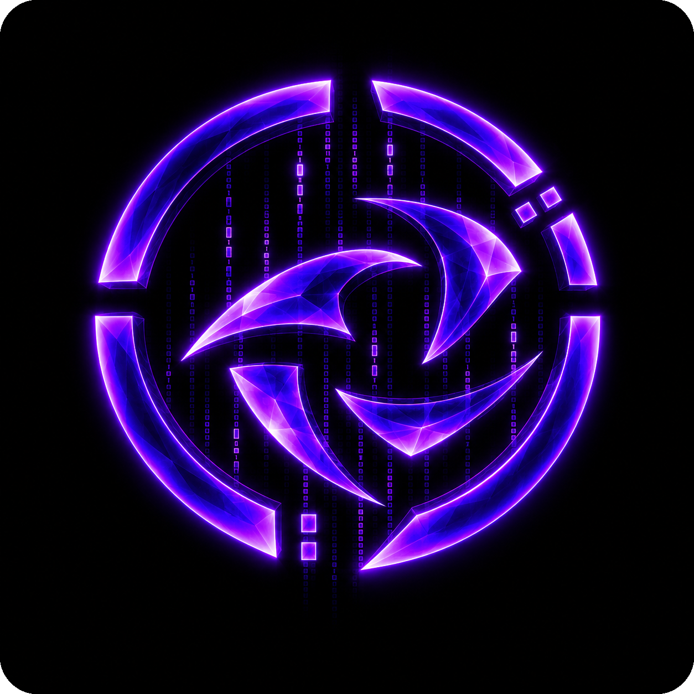
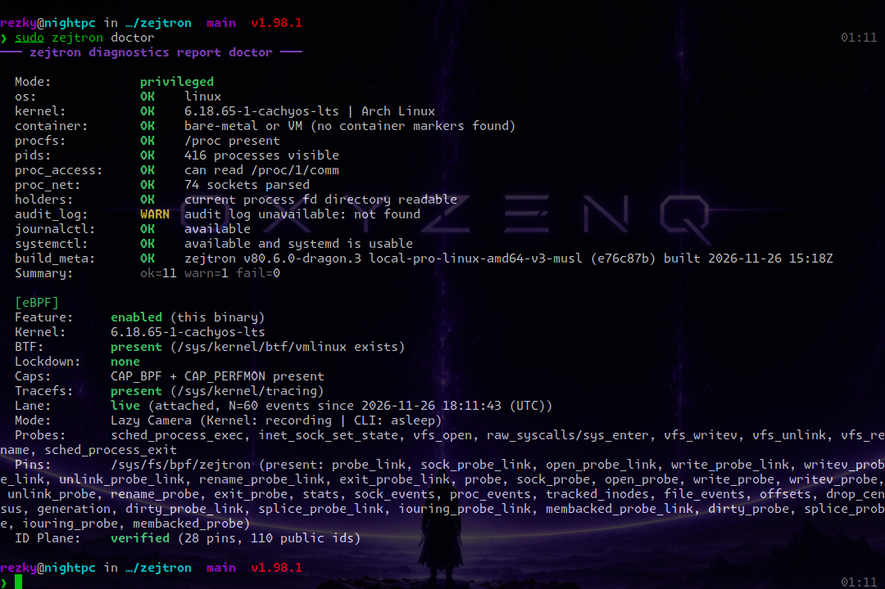
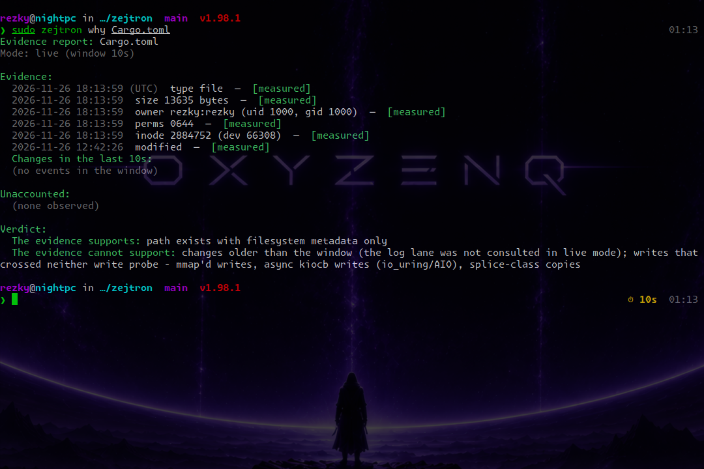

<!--
  SPDX-FileCopyrightText: 2025-2026 rezky_nightky (oxyzenQ)
  SPDX-License-Identifier: AGPL-3.0-only OR Commercial
-->

> **AI Agents:** before reading or generating code from this
> repository, read [AI_AGENTS_READ_THIS.md](AI_AGENTS_READ_THIS.md).
> Respect the intellectual property: AGPL-3.0-only, or a commercial
> license - nothing between.

<p align="center">
  
</p>

<h1 align="center">zejtron</h1>

<p align="center">
  <strong>Read-only evidence ledger for the Linux host. Native kernel readers, eBPF event windows, zero external wrappers. Boring and serious.</strong>
</p>

<div align="center">

> The operator asks. The host answers.
> zejtron reads the evidence and prints the ledger — nothing more, and never less.

</div>

zejtron's output complies with the [Evidence Ledger Specification v4](docs/EVIDENCE-LEDGER.md). See [docs/EVIDENCE-LEDGER.md](docs/EVIDENCE-LEDGER.md) for the citable format.

<p align="center">
  <a href="https://ko-fi.com/rezky">
    
  </a>
</p>

## Demo

<p align="center">
  
</p>

<p align="center">
  
</p>

## Why zejtron?

An investigation fragments across five tools: `which` for the binary, `ss` for the port, `lsof` for the holder, `ps` for the tree, and `journalctl` for the evidence — each with its own output dialect, none of it deterministic.

zejtron is one binary that answers the incident questions in one dialect. The output is deterministic, the timestamps are UTC with an explicit marker, and the tool never writes. night-frontier-Z2 proves the determinism claim every push: the certificate leg renders canonical fixtures in two independent invocations and issues a certificate only when the byte diff is empty - and the parser dialect corpus (real GA kernel BTF bytes under `corpus/`) locks the parsers to real kernels from 5.10 (the below-floor dialect bundle) through 7.3.3 (BTF).

### What makes zejtron sharp

- **One binary, ten surfaces** — path, recent, port, proc, holds, touch, why, net, doctor, plus `sig` (the build-signature self-check). For the single-question case, kernel-native tools are faster. zejtron is the tool for the multi-question case: when you would otherwise string five tools together and parse five dialects, zejtron answers in one grammar with diffable output.
- **Read-only by design** — it does not kill processes, close ports, start or stop services, or modify files. Ever.
- **Deterministic output** — the same evidence, the same bytes, on every host. Piped output carries zero escape bytes.
- **UTC everywhere** — evidence timestamps render `YYYY-MM-DD HH:MM:SS (UTC)`, computed by Howard Hinnant's civil_from_days on `std::time` only. No timezone database, no local guesses in containers.
- **Root-honest** — `--check-update`, the one network surface, refuses sudo by name.
- **Kernel-Source Cross-Validation** — the kernel's own views of one host are reconciled against each other: the directory listing against the direct `/proc/<pid>` lookup and the recorded pid's birth, the audit log's deletion records against the event ring's window, the pinned pin estate against the public BPF ID plane. A stealth mechanism that forces the kernel to contradict itself prints as an Unaccounted entry with the honest cautions beside it (night-frontier-Z11, D8). The ID plane check reads the privileged enumeration and names its absence honestly when the reader holds no `CAP_SYS_ADMIN`; the detonation proof runs inside the CI's kernel-floor micro-VM.
- **Pro mode on `--help`** — the complete options estate on one surface, grouped by the verbs that own them, aliases disclosed.

### Where eBPF Meets Forensics

zejtron sits at the intersection of observability and forensics. The observability side diagnoses CPU, RAM, disk, and network. The forensics side captures file writes, process executions, and socket states, rendering them through the Evidence Ledger's provenance tiers.

The eBPF lane is a lazy camera, not a monitoring daemon. Sysdig or Datadog run always-on userland agents; zejtron's probes are planted on request (`doctor --attach`), the kernel records events into its own bounded trace buffers, and the evidence drains only when an operator asks a question (`why --raw`, the event windows). The camera arms and disarms at the operator's command (`doctor --detach`), and no agent, stream, or backend exists in between.

The camera never intervenes. Falco and Tetragon sit on the enforcement side — they can kill and block; zejtron is read-only, documenting an incident without perturbing it. The honesty is in the ledger: every row carries its provenance tier (`[observed]`, `[measured]`, `[inferred]`), so the analyst knows which evidence is direct and which is circumstantial, and the report names what it could not see (`[unaccounted]`) instead of guessing. And where the kernel's own views disagree with each other, the report records the disagreement instead of picking a side: zejtron is not a rootkit hunter, but it is a ledger of named disagreements — it cross-validates the kernel's own sources of truth (the directory listing against the direct `/proc/<pid>` lookup, the audit log's deletion records against the event ring's window), and if a stealth mechanism forces the kernel to contradict itself, the bytes of that contradiction land in the Unaccounted block, with the honest cautions beside them (night-frontier-Z11).

### The Dependency & Wrapper Doctrine

Two structural decisions define the tool's footprint. Both are audited facts, not aspirations.

**Peak lean dependency.** The runtime graph is exactly three crates: `clap` (CLI), `aya` (eBPF loader), and `libc` (the one raw call for SIGPIPE reset). There is no `serde`, no `tokio`, no `libbpf`, no `chrono` (banned in `deny.toml`, replaced by Hinnant's `civil_from_days`), and no regex crate of any size - the pattern filter is std-only substring matching, and the one regex-shaped call site escapes its argument for `journalctl`'s own engine by hand (`night-dragon-maintenance-T1` removed a dead `regex-lite` that zero call sites imported). The JSON output lane hand-writes its serializer to keep the crate count at three. In comparison: `sysdig` carries libbpf and Lua; `bpftrace` carries LLVM and BCC.

**Native kernel reader, not a wrapper.** The ten surfaces read `/proc` and `/sys` directly. Delete `ss`, `lsof`, and `ps` from the system — zejtron still answers byte for byte. The complete external-binary census is short, and every entry is an optional lane that degrades honestly when absent: `curl` (for `--check-update`), `journalctl` (optional log fallback), `dpkg`/`rpm`/`apk` (optional package ownership on those distros), and `uname` (readiness check). The Arch pacman database is read directly from `/var/lib/pacman`.

### Origin projects (consolidated)

zejtron is the consolidation of two earlier projects — pidnest and Zenlixem — into one release flow. Old muscle memory is honored at the CLI.

| Origin | Tool | zejtron surface |
| --- | --- | --- |
| pidnest | process trees | `zejtron proc` |
| Zenlixem | whoholds | `zejtron holds` |
| Zenlixem | lasttouch | `zejtron touch` |
| Zenlixem | whyopen | `zejtron why` |
| Zenlixem | doctor (network) | `zejtron net` |
| Zenlixem | envpath | `zejtron path` |

### Tools it replaces

| The old path | The zejtron surface |
| --- | --- |
| `which <cmd>` | `zejtron path <cmd>` |
| `ss -tlnp` | `zejtron port --tcp --group` |
| `lsof -i :<port>` | `zejtron holds <port>` |
| `lsof <path>` | `zejtron holds <path>` |
| `ps auxf` | `zejtron proc --me` |
| `journalctl -u <unit>` | `zejtron why <path-or-port>` |

Five tools, five dialects, one investigation. zejtron answers the same questions in one dialect, deterministically, with diffable output.

### Intended Environments and Users

**Servers — production hosts and containers.** The primary ground. One statically linked binary. No daemon, no background agent, no writes to disk. Drop it, run it, read the evidence. Deterministic UTC output survives production use: two runs print the same bytes, so a report can be diffed, attached to a post-mortem, or filed as a compliance record.

**Desktops — developer workstations.** The same binary answers local questions: which process holds port 3000, what last modified that config, where the RAM went. Runs, prints, exits.

**Power users and sysadmins.** For those who already string `ss`, `lsof`, `ps`, and `journalctl` together and parse four dialects. Those tools remain faster for single questions; zejtron carries the investigation in one grammar, with every row naming its source.

**Security and forensics.** Read-only by design. Does not alter system state or disturb forensic timestamps. Safe to run during an active incident.

**Who should not use zejtron.** Beginners wanting a GUI dashboard (GNOME System Monitor). Anyone needing continuous real-time monitoring — zejtron collects evidence and exits. It is an investigative CLI, not a monitoring daemon.

## Quick Start

### Requirements

- Linux with procfs at `/proc` (x86-64-v3/v4 are the shipped shapes).
- rust 1.98.1 (pinned in `rust-toolchain.toml`) for source builds.
- Optional: `journalctl` (log fallback); Arch pacman database at `/var/lib/pacman`; `dpkg`/`rpm`/`apk` for package ownership on those distros.

### Architecture Support

Pre-built binaries ship for **x86_64 (amd64)** only. The verifier-first doctrine is the reason: we ship exactly what we can test end-to-end on our hardware through the Supermassive E2E suite.

If your infrastructure runs on ARM64, ppc64le, or RISC-V, the source is pure Rust (AGPL-3.0) — build from source. Enterprise Internal license holders ($49,999/year) can request an officially verified build for their architecture: we compile, run the full test suite, and provide the verified artifact.

### Install on my machine

```sh
./scripts/package/install-on-my-machine.sh
```
Detects the x86-64 level, builds the release tier, and installs to `/usr/bin`. Linux amd64 with rust required.

### Install from a release

The release matrix ships two shapes: x86-64-v3 and v4, both fully static musl (v3 covers Haswell 2013+; v4 covers AVX-512 2017+). One libc, zero runtime dependencies — runs on glibc distros, Alpine, and scratch containers.

```sh
TAG=v80.6.1
SHAPE=linux-amd64-v3-musl   # or v4-musl
curl -LO "https://github.com/oxyzenQ/zejtron/releases/download/${TAG}/zejtron-${TAG}-${SHAPE}.tar.gz"
curl -LO "https://github.com/oxyzenQ/zejtron/releases/download/${TAG}/zejtron-${TAG}-${SHAPE}.tar.gz.sha512sum"
sha512sum --check "zejtron-${TAG}-${SHAPE}.tar.gz.sha512sum"
tar -xzf "zejtron-${TAG}-${SHAPE}.tar.gz"
install -Dm755 zejtron "$HOME/.local/bin/zejtron"
```
Each release ships SHA-512, BLAKE3, SHAKE256, and a GPG signature. See [Release Verification](#release-verification).

### Install from crates.io

```sh
cargo install zejtron --locked
```
The registry lane ships the full eBPF binary (maintainer-built object in `ebpf-prebuilt/`). No nightly, no bpf-linker on the target. The eBPF support is unconditional; no feature opt-out exists.

### Install from source

```sh
./scripts/setup.sh               # full bring-up + self-test
./scripts/setup.sh --skip-heavy  # bootstrap + build + self-test only
```
Or the classic path:
```sh
git clone https://github.com/oxyzenQ/zejtron
cd zejtron
cargo install --path .
```

Every binary names its own build shape in `zejtron -V`: `Build: local-...` for anything built on the machine you are standing on (the alias name under the `local-` marker for alias builds, the detected arch-libc shape for plain builds), `Build: pro-...` for a binary downloaded from the release page. [docs/VERIFY_RELEASE.md](docs/VERIFY_RELEASE.md) owns the full contract.

### eBPF & The Lazy Camera

The eBPF event lane ships in every binary. No program loads until you attach.

```sh
./scripts/dev/bootstrap-ebpf.sh   # once per machine, for source builds
cargo pro-linux-amd64-v3-musl     # source-builds and embeds the object
```
The build cross-compiles `ebpf/` (pure Rust, aya-ebpf) into twelve programs (the eight core probes plus the capability-gated off-path set): `sched_process_exec`, `inet_sock_set_state`, `vfs_open`, `vfs_writev`, `vfs_unlink`, `vfs_rename`, `sched_process_exit`, and the `raw_syscalls/sys_enter` write probe. The nightly toolchain and bpf-linker are build-time prerequisites only. Runtime requires kernel 5.15+, lockdown inactive, and `CAP_BPF` + `CAP_PERFMON` for attach. Attach verifies every struct offset against the host's vmlinux BTF, refuses on missing members, and knows the anonymous unions modern kernels use (6.18's `struct file` carries `f_path` inside one). The fd-walk offsets are parsed from BTF at attach and written whole into the offsets map. The unlink probe's `vfs_unlink` dentry argument position is scanned out of the same BTF - the signature moved its dentry across the floor, so the position is per-host data, never a compiled guess - and the rename probe walks `renamedata.old_dentry` at its BTF-derived offset. If the write probe's self-verification fails, the refusal echoes the planted offsets beside the drop census. night-frontier-Z1 closes the verification loop around the recording boundary: the file ring's drain re-derives the planted walk table from the kernel's current BTF and refuses by slot on drift, before one record is trusted. night-frontier-Z2 adds the estate's identity: the camera stamps its boot identity, its probe object identity, and the attach instant into a pinned `generation` map at attach, and every drain re-derives the live facts before one record is trusted - a camera planted by another boot or another build refuses by name, with the remedy.

```sh
sudo zejtron doctor --attach   # plant the probes
sudo zejtron doctor --detach   # the sledgehammer: unpin everything, idempotent
```
After `--attach`, the process may exit. The pinned links keep programs attached; the pinned maps keep data. `--detach` sweeps the whole pin estate (legacy pins, foreign entries) — no manual `rm` is ever needed. Both verbs are quiet by default: the attach answers with one line — `eBPF probes attached successfully (12 programs, 12 links, 8 maps). Lazy Camera is now recording.` — and the detach with `eBPF probes detached (32 pins removed).`; run either with `-v` when you want the full report instead (every probe by name, the BTF verification claims, the whole pin list). The Lazy Camera architecture is exactly this: the kernel records into bounded rings, nothing streams to userspace, and the CLI wakes only to drain the window it was asked for, then exits. The doctor's `[eBPF]` section carries the camera's posture: `Mode: Lazy Camera (Kernel: recording | CLI: asleep)`.

### Usage

Every command once — flags live in `--help` (Pro mode owns the complete estate). All data surfaces speak typed JSON (`--print-json`), and every report is jq-ready.

```sh
# Path, ports, processes, holders, and evidence
zejtron path sh
zejtron port --tcp --group
zejtron proc --me --depth 1
zejtron proc --find ssh --depth 2
zejtron holds /etc/resolv.conf
zejtron touch /etc/resolv.conf
zejtron why /etc/resolv.conf --since 30s --trace --raw

# Typed JSON for automation (Spec v4)
zejtron why /etc/passwd --print-json | jq '.measured[] | select(.kind=="size") | .bytes'
zejtron proc --print-json | jq '.processes[] | select(.comm=="sshd") | .pid'
zejtron holds 53 --print-json | jq '.verdict.supports'
zejtron doctor --print-json | jq '.os, .kernel, .ebpf_lane'

# The SRE loop, end to end
zejtron doctor --symptom ram --print-json | jq '.processes[] | select(.pss_bytes > 100000000) | .pid'
zejtron port 9999 --print-json | jq '.ports[].owners'
zejtron path "$(which python3)" --print-json | jq '.active.package'

# Network, readiness, version, build signature
zejtron net
zejtron doctor
zejtron sig
zejtron -V

# The diagnostic trace (engine logs to stderr, report stays clean)
zejtron why /etc/passwd -v
```

`-v` prints `[engine]`, `[btf]`, and `[lane]` one-liners to stderr; stdout remains byte-clean for pipes. `docs/EBPF_LIFECYCLE.md` is the troubleshooting reference.

## Limitations (honest)

- **v80.0.0 LTS freeze is in effect.** The CLI contract takes no breaking changes from v80.0.0 on; future releases carry bug fixes, compatibility, and performance only.
- **Without sudo**, port owners and some holder details show as `unknown`. The kernel hides other users' context; zejtron reports what is visible.
- **No subcommand wraps an external tool.** The ten surfaces read `/proc` and `/sys` directly. Optional external commands are `journalctl`, `dpkg`/`rpm`/`apk`, and `uname` — all degrade honestly when absent.
- **Audit and journal evidence is best-effort**, depending on `/var/log/audit/audit.log` readability, `journalctl` availability, and retention.
- **Inside a container**, zejtron sees the container's `/proc`. Host processes are not visible unless `--pid=host` is used.
- **The eBPF lane ships unconditionally.** There is no snapshot-only build; the doctor names the lane in every binary.
- **Event windows** (`port --since`, `holds/touch/why --since`) require the eBPF lane, root, BTF, and kernel >= 5.15. The ID plane cross-validation (the pin estate against the kernel's own BPF id enumeration) is privileged in a stricter way - it needs `CAP_SYS_ADMIN` even to enumerate, so a reader without it gets the named absence (`unavailable (requires CAP_SYS_ADMIN)`), and a stealth mechanism that hides consistently from every view the kernel offers still hides from zejtron. Without them, the surfaces fall back to journalctl or snapshot-only with an honest unaccounted block, and every event-window verb opens its human output with a `Mode:` banner (`Mode: live` when the kernel lane watched, `Mode: snapshot` with the fallback reason when it did not) so a degraded window always names itself. The camera's question map is bounded (1024 questions): when stale questions from killed commands have filled it, a new question refuses by name - counted in the camera's census and cleared by the next `doctor --detach` (night-frontier-Z5). A window that spans a host suspend names its sleep blackout: the CLOCK_BOOTTIME-MONOTONIC divergence is the kernel's own suspend accounting, so the span the host spent asleep renders as proof of absence - no event can exist there (night-frontier-Z6). And a window whose span reaches back past the camera's own attach instant names the pre-attach span as proof of absence too - the watcher's own absence, compared in the stamps' clock domain (night-frontier-Z10): the absence triad is complete (drop truth + sleep truth + watch truth = no silent absence), and a mid-capture clocksource regime switch renders as an Unaccounted row rather than reading as one precision class. And since night-frontier-Z11 the kernel's own disagreements are named where they can be seen: a deletion the audit log recorded inside the window that the event ring holds no unlink or rename for (the anchor-inode guard holds the benign delete-and-recreate shape out) renders as the silent-deletions boundary, and a recorded pid the namespace's listing does not show - or one whose /proc identity was born after the recorded event, so the recycled holder's name never renders as the actor - renders as the hidden-pids and recycled-pids boundaries instead of the old shrugged "no visible PID" - the count counts events, and each entry carries its per-pid split (up to a bounded 32-pid sample, ascending pid order) so the "how many distinct processes is that" question is answered inside the entry, never left to a misread; every one of them carries its honest cautions beside the facts, never an accusation. And the live window's own shape is said plainly (night-witness-pids): the camera records only what happens while it watches - the kernel-side filter is keyed during the capture and the requested `--since` span is spent watching, so the event lane has no pre-watch lookback - and the bounded rings drain on read, so a repeated query consumes the history its predecessor already took. Evidence older than the watch rides the log lane (the audit trail, `recent`, `touch`, the snapshot facts), never the camera's record.
- **Live file probes** record `write(2)` via `raw_syscalls/sys_enter`, vectorized paths via `vfs_writev`, and - since the unlink/rename probes - the death and movement of the watched file via `vfs_unlink` and `vfs_rename` (the record carries who acted, the record does not carry the new name). And since night-frontier-Z7 (D4) the off-path write truths ride the same camera: an mmap'd write is recorded through the kernel's own page-dirty path (`filemap_dirty_folio` on folio kernels, `__set_page_dirty_nobuffers` on the folio-less line - the anchor chosen from the host's own BTF at attach), splice-class copies are recorded through the write probe's own syscall tracepoint with both descriptors resolved (the direction named: into the file, or the file's content moving away), and async kiocb writes are recorded through the io_uring submit tracepoint with the request descended to its file through BTF-walked offsets and the write-class opcode filter. Every off-path capability is record-verified at attach (a real action must come back through the probe) and named in the attach summary; a capability the host cannot vouch for is unplanted and named down, never guessed. And since night-frontier-Z9 (D6) the memory-backed class rides the same camera: a store through a MAP_SHARED mapping on a tmpfs/ramfs file (`memfd_create` rides tmpfs's superblock class) crosses the shared-write fault path - the one mechanism the store cannot skip - and the anchor there (`fault_dirty_shared_page` on the 5.15-6.8 line, the surviving `wp_page_shared` arm on the 7.x line - per-host BTF data, the corpus pins the ladder's verdict per dialect) records it after the class gate reads the superblock's registered filesystem name at event time (`tmpfs`/`ramfs` - the kernel's own registration table, never a compiled guess; a regular file's fault crosses the same anchor and stays silent here, the dirty anchor's record instead - one store, one record). What stays named: the 7.x line's non-present fault arm is inlined past any vouchable symbol, so a FIRST store through a fresh PTE on a 7.x host stays outside the record there (the write-protection arm still sees its faults; the coverage is partial, the corpus pins it, and the capability plants only where a real memfd store proves it), vmsplice's direction is flags-dependent and stays outside the splice record, O_PATH peeks never reach vfs_open, and the log lane may catch what the kernel lane does not. Every record carries its actor's identity block (night-frontier-Z8, D5): the cgroup id, the comm, and the network-namespace inode, read by the kernel at event time - so "who did this, and from where" is answered in container environments without a cross-lookup, and an actor whose /proc entry is gone before the query renders still names itself in the row. And when a ring fills, the drop is no longer silent (night-frontier-Z1): each failed reservation counts in the drop census - one slot per ring, read back through its pin - and the Unaccounted blocks name how many events the camera saw but could not hold. The civil times the rows carry are honest down to their own sample (night-frontier-Z2): every row renders under the one wall offset the renderer sampled, and a wall clock that moved more than half a rendered second across the capture is named in the report instead of riding the times silently.
- **`doctor --symptom ram`** reads /proc, permission-gates other users' memory, and drains a 5-second exit ring when attached. The `cpu`, `disk`, `network`, and `gpu` lanes sample a 1.0-second delta; they are snapshots, never monitors. **`doctor --symptom slow`** is the umbrella: it composes the cpu, disk, memory, and network lanes over ONE shared 1.0-second window (one sleep, simultaneous evidence), adds the swap rate from /proc/vmstat, and ranks the cross-lane signatures — swap pressure, stuck I/O, iowait, memory pressure, CPU saturation, runnable queue, socket churn — into one severity-ordered answer.

## Safety Features

- **Read-only by design** — no kill, no port close, no service control, no file writes. `zejtron touch` inspects evidence; it does not modify timestamps.
- **Root refusal with a name** — `--check-update` refuses sudo by name before any network I/O.
- **Capability-honest color** — truecolor when supported, plain bytes when piped, `NO_COLOR` honored everywhere.

## Architecture

One crate, one binary, one discipline:

```
src/
  main.rs        — entry point + dispatch (the ONLY file at src/ root)
  cli/           — clap derive definition, brand styling, the UX bridge
  commands/      — the ten surfaces (+ lane*.rs, the fallback ladder)
  evidence/      — the Evidence Ledger format (rows, tiers, render)
  ebpf/          — the eBPF userspace lane (loader, rings, BTF)
  info/          — the -V report + the std-only civil clock
  output/        — the runtime color tier (capability ladder, error lane)
  system/        — /proc readers, the pacman reader, path guardrails
  update/        — --check-update (refuses root, fail-closed)
```

Every `.rs` file rides at or under the 600-line cap, every test file lives under `test/`, and every gate runs in CI. See [CONTRIBUTING.md](CONTRIBUTING.md) for the full map.

### The Evidence Ledger

`holds`, `touch`, and `why` answer with the same format: a subject, a mode line, an Evidence block, an Unaccounted block, and a two-line verdict. Every row carries exactly one provenance tag: `[observed]` (eBPF kernel event), `[measured]` (snapshot read), `[inferred]` (log replay), or `[unaccounted]` (what the report cannot see). Four tiers, no fifth. The tag is the truth about the source. The ladder is exclusive and every run names its lane: live, journal fallback, or no event lane available.

## Philosophy

**The boring and serious.**

zejtron stays out of the operator's way while doing serious investigative work underneath. The interface rarely changes. Output is deterministic and read-only by design. Every release makes it slightly more stable, slightly sharper, and slightly easier to maintain.

### What zejtron IS

- A read-only investigator's command center
- Deterministic output you can diff, pipe, and archive
- Honest about what the kernel actually shows

### What zejtron will NEVER be

Scope is a contract, not a mood. Each wall below is a refusal by design, not a
feature request parked for later - a proposal that crosses one is answered
"no" in the same breath it is asked, because a tool's identity is defined
less by what it does than by what it refuses to become.

- **Control plane** — a process killer, port closer, service controller, or any writer of host state. zejtron observes; the operator acts.
- **Resident** — a daemon, background agent, telemetry endpoint, phone-home beacon, or anything that lives between runs. Every invocation is a start, a print, an exit.
- **Sound** — a speaker, a beep, a voice, a desktop notification, or an alerting surface. Evidence is text on a terminal; if it matters, the operator reads it.
- **Entertainment** — a game, a demo toy, or any surface that exists to be watched instead of read. Nothing here animates for its own sake.
- **Dashboard** — a GUI, TUI, web UI, or mouse-first face. The rendered ledger is the only presentation layer, and it pipes cleanly to `jq`, `grep`, and `diff`.
- **Collection** — a monitoring platform, metrics store, time-series database, or long-running sampler. zejtron collects evidence and exits; the window closes with the process.
- **Network face** — a listener, an RPC server, a control socket, or anything another machine can connect to. The one egress lane is the opt-in, root-refusing `--check-update`.
- **Supply** — a package manager, plugin loader, auto-installer, or updater of other software. It reads systems; it does not feed them.
- **Autonomy** — an AI agent, an auto-remediation engine, or anything that decides instead of reporting. The verdict names what the evidence shows; the judgment stays human.
- **Genie** — a cross-platform shim or a library API. Linux, `/proc`, and `/sys` are the whole ground, and one binary is the whole product.
- **A guesser** — a tool that fabricates what it cannot see. Where evidence ends, the `[unaccounted]` tag begins.

The walls are load-bearing. Every dependency that wants in, every flag that
wants a name, every byte the renderer prints must fit inside them - which is
why the dependency doctrine below is a scope decision and not just a size
decision.

### Stable API

The CLI surface froze at v80.0.0. No breaking changes to commands, flags, or output format. Future releases focus on bug fixes, procfs/sysfs compatibility, and internal performance.

### Release channels

Stable releases are tagged `vX.Y.Z` from `main`. The release pipeline validates the tag, builds the two-leg musl matrix, and publishes with checksums; pre-release tags are never marked "latest".

## Contributing

PRs ride the DCO: every commit carries a `Signed-off-by:` line (the [CLA](CLA.md) acceptance), gates must stay green, and structure laws hold. See [CONTRIBUTING.md](CONTRIBUTING.md).

## Security

zejtron writes nothing. Its attack surface is the network lane (`--check-update`), which refuses root and verifies tags fail-closed. Report vulnerabilities per [SECURITY.md](SECURITY.md).

## Documentation

- [docs/README.md](docs/README.md) — the documentation index: the ownership registry every doc is measured against (the DOC_AUDIT.md rule 3 seat)
- [docs/USAGE.md](docs/USAGE.md) — the usage playbook: investigation scenarios and how to read the Evidence Ledger
- [docs/INNOVATIONS.md](docs/INNOVATIONS.md) — the innovation ledger: the named mechanisms behind the tool and where their truth lives
- [docs/FAQ.md](docs/FAQ.md) — the FAQ: root and privileges, kernel support, where the eBPF objects come from, and the deployment shapes (desktop, server, ultra scale)
- [docs/BRANDING.md](docs/BRANDING.md) — the brand and color system
- [docs/RULES.md](docs/RULES.md) — the engineering rules
- [docs/ROADMAP.md](docs/ROADMAP.md) and [docs/ROADMAP-current.md](docs/ROADMAP-current.md) — direction
- [docs/VERIFY_RELEASE.md](docs/VERIFY_RELEASE.md) — release verification
- [docs/FREEZE.md](docs/FREEZE.md) — the v80.0.0 LTS freeze declaration
- [docs/LICENSING_FAQ.md](docs/LICENSING_FAQ.md) — licensing questions
- [docs/MAINTENANCE.md](docs/MAINTENANCE.md) — the maintenance record: armed incident classes and their recoveries
- [docs/workflow/about-ci.md](docs/workflow/about-ci.md) — the CI estate

## Test Results

The suite is the contract: green at every landing, plus the CLI battery per supermassive leg (MSRV/stable, host/musl), the miri UB lane, the cargo-fuzz lane (three hostile-input targets), the container E2E leg, and the alpine musl smoke proof (ten probes on the digest-pinned alpine:3.20 rootfs). CI blocks the merge on every one of them.

## Release Verification

Each archive ships SHA-512, BLAKE3, and SHAKE256 checksums, plus a detached GPG signature. Full instructions live in [docs/VERIFY_RELEASE.md](docs/VERIFY_RELEASE.md).

## Support

Built and maintained independently by **rezky_nightky (oxyzenQ)**. If this project sharpened your incident work, you can support maintenance via Ko-fi or crypto:

- **Solana** — `SOL` / `USDT` (SPL): `88umzS7abaToaGQVgTVXt5SnuvcjTw2jPSM6Ha2JYmXM`
- **Ethereum** — `ETH` / `USDT` / `USDC` (ERC-20): `0x1bCbA21c07B5636a942De27AA7Ee8283cEDb4C3D`
- **Bitcoin** — `BTC` (Taproot, P2TR, `bc1p`-prefixed): `bc1p88nqysn4p8u9zxwz2pyxs5pl77wllcrk6ca2r2l3ryr3863hxkys5vdkze`

<p align="center">
  
  &nbsp;&nbsp;
  
  &nbsp;&nbsp;
  
</p>

Support is optional. The project remains open-source.

## Intellectual Property & Trademark

**zejtron** is the exclusive intellectual property of **rezky_nightky (oxyzenQ)**.

- Source code: **AGPL-3.0-only** (see [LICENSE](LICENSE)). Commercial use that cannot meet copyleft is available under [COMMERCIAL_LICENSE.md](COMMERCIAL_LICENSE.md).
- Name, logo, and branding ("the Marks"): governed by [TRADEMARK.md](TRADEMARK.md), reserved by the owner. Unauthorized rebranding or relicensing is prohibited.
- For trademark licensing, contact [github.com/oxyzenQ](https://github.com/oxyzenQ).

## Commercial Licensing

Companies using zejtron in production need a commercial license. zejtron is dual-licensed: AGPL-3.0-only for open-source, and a Commercial License for proprietary use.

| Tier                 | Price          | Target                                                     |
| -------------------- | -------------- | ---------------------------------------------------------- |
| Personal             | Free (AGPL-3.0) | Hobby, personal, non-commercial, open-source contributions |
| Professional         | $1,899/year    | Solo devs, freelancers, revenue under $100K/year           |
| Business             | $9,999/year    | Startups, SMBs, revenue $100K to $10M/year                 |
| Enterprise Internal  | $49,999/year   | Enterprise revenue over $10M/year, internal use only, NO redistribution |
| OEM / Redistribution | $99,999/year OR $169,999 one-time + $34,000/year maintenance | Embedding or reselling in a shipped product; redistribution rights |

The paid rungs follow the value upward. Revenue anchors are self-declared in good faith. The canonical pricing table, the OEM pricing note, and the tier grants live in [COMMERCIAL_LICENSE.md](COMMERCIAL_LICENSE.md); this table mirrors it.

zejtron's entry paid tier is Professional at $1,899/year — the serious-tool standard, matching zelynic. This is a serious LTS project with audits, formal declarations, and verifiable claims; the commercial buyer is a professional whose infrastructure value pays off the license in one shift. The $99 Individual tier was retired in this revision; any Individual-tier customer who bought before this revision is grandfathered at $99 for the term they bought. The market calibration and full reasoning live in [COMMERCIAL_LICENSE.md](COMMERCIAL_LICENSE.md#why-zejtron-starts-at-1899-not-99).

The Personal tier (Free, AGPL-3.0) still covers hobby, learning, and open-source contributions — the honest path for anyone who does not need commercial rights.

**Unauthorized use is theft.** Taking this code without contacting the owner and paying the license is prohibited. The honest paths are two: comply with AGPL-3.0-only, or buy the tier your use matches.

Payment is USD-pegged crypto (Solana / Ethereum / Bitcoin). Licensing contact: [oxyzenQ@proton.me](mailto:oxyzenQ@proton.me). Questions: [docs/LICENSING_FAQ.md](docs/LICENSING_FAQ.md).

## License

Dual-licensed: **AGPL-3.0-only** for open-source use (see [LICENSE](LICENSE)), or the **Commercial License** for proprietary use (see [COMMERCIAL_LICENSE.md](COMMERCIAL_LICENSE.md)).

---

© 2026 rezky_nightky (oxyzenQ). All rights reserved. zejtron and the zejtron logo are trademarks of rezky_nightky (oxyzenQ).

<p align="center">
  <em>built with curiosity</em>
</p>

<!-- ZEJTRON-DISCLAIMER -->
<!--
  Documentation Disclaimer — read before relying on any data point.

  This document may contain stale data, hardcoded counts, or outdated
  file paths and symbol names. Maintainers update source code but may
  forget to sync every doc — perfect sync across every .md file is a
  known maintenance burden with diminishing returns.

  Source code (`src/**/*.rs`) is the single source of
  truth. Always cross-check against the actual source files before
  relying on any specific number (target count, LOC, rate bound),
  file path, function name, or config key.

  If you find a discrepancy, please open a PR — the doc is wrong, not
  the source.
-->
