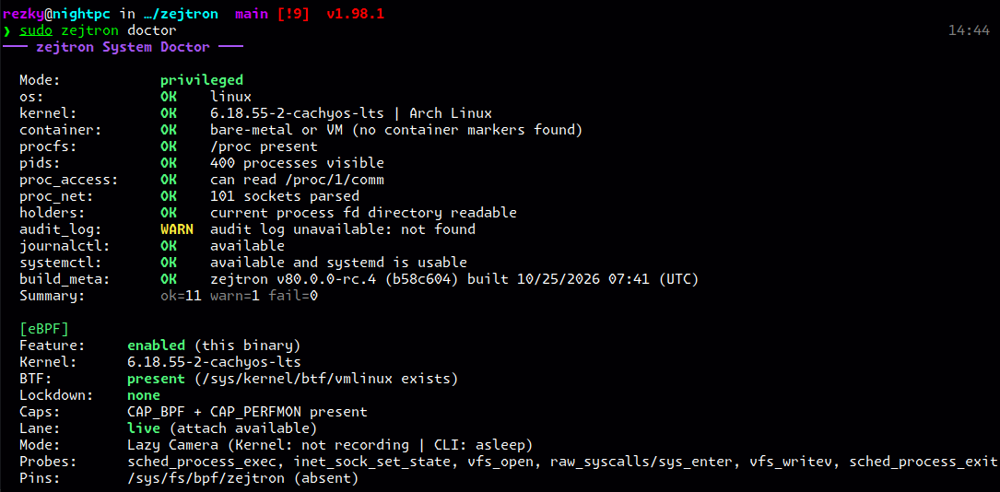
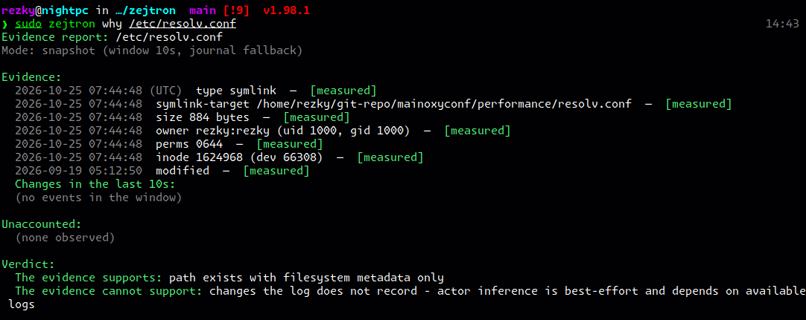

<!-- Copyright (C) 2026 rezky_nightky -->
<!-- SPDX-License-Identifier: GPL-3.0-only -->

> **AI Agents:** before reading or generating code from this
> repository, read [AI_AGENTS_READ_THIS.md](AI_AGENTS_READ_THIS.md).
> Respect the intellectual property: GPL-3.0-only, or a commercial
> license - nothing between.

<p align="center">
  
</p>

<h1 align="center">zejtron</h1>

<p align="center">
  <strong>Read-only evidence ledger for the Linux host. Native kernel readers, eBPF event windows, zero external wrappers. Boring and serious.</strong>
</p>

<div align="center">

> The operator asks. The host answers.
> zejtron reads the evidence and prints the ledger — nothing more, and never less.

</div>

zejtron's output complies with the [Evidence Ledger Specification v3](docs/EVIDENCE-LEDGER.md). See [docs/EVIDENCE-LEDGER.md](docs/EVIDENCE-LEDGER.md) for the citable format.

<p align="center">
  <a href="https://ko-fi.com/rezky">
    
  </a>
</p>

## Demo

<p align="center">
  
</p>

<p align="center">
  
</p>

## Why zejtron?

An investigation fragments across five tools: `which` for the binary, `ss` for the port, `lsof` for the holder, `ps` for the tree, and `journalctl` for the evidence — each with its own output dialect, none of it deterministic.

zejtron is one binary that answers the incident questions in one dialect. The output is deterministic, the timestamps are UTC with an explicit marker, and the tool never writes.

### What makes zejtron sharp

- **One binary, nine surfaces** — path, recent, port, proc, holds, touch, why, net, doctor. For the single-question case, kernel-native tools are faster. zejtron is the tool for the multi-question case: when you would otherwise string five tools together and parse five dialects, zejtron answers in one grammar with diffable output.
- **Read-only by design** — it does not kill processes, close ports, start or stop services, or modify files. Ever.
- **Deterministic output** — the same evidence, the same bytes, on every host. Piped output carries zero escape bytes.
- **UTC everywhere** — evidence timestamps render `YYYY-MM-DD HH:MM:SS (UTC)`, computed by Howard Hinnant's civil_from_days on `std::time` only. No timezone database, no local guesses in containers.
- **Root-honest** — `--check-update`, the one network surface, refuses sudo by name.
- **Pro mode on `--help`** — the complete flag estate on one surface, grouped by the verbs that own them, aliases disclosed.

### Where eBPF Meets Forensics

zejtron sits at the intersection of observability and forensics. The observability side diagnoses CPU, RAM, disk, and network. The forensics side captures file writes, process executions, and socket states, rendering them through the Evidence Ledger's provenance tiers.

The eBPF lane is a lazy camera, not a monitoring daemon. Sysdig or Datadog run always-on userland agents; zejtron's probes are planted on request (`doctor --attach`), the kernel records events into its own bounded trace buffers, and the evidence drains only when an operator asks a question (`why --raw`, the event windows). The camera arms and disarms at the operator's command (`doctor --detach`), and no agent, stream, or backend exists in between.

The camera never intervenes. Falco and Tetragon sit on the enforcement side — they can kill and block; zejtron is read-only, documenting an incident without perturbing it. The honesty is in the ledger: every row carries its provenance tier (`[observed]`, `[measured]`, `[inferred]`), so the analyst knows which evidence is direct and which is circumstantial, and the report names what it could not see (`[unaccounted]`) instead of guessing.

### The Dependency & Wrapper Doctrine

Two structural decisions define the tool's footprint. Both are audited facts, not aspirations.

**Peak lean dependency.** The runtime graph is exactly four crates: `clap` (CLI), `regex-lite` (pattern engine), `aya` (eBPF loader), and `libc` (the one raw call for SIGPIPE reset). There is no `serde`, no `tokio`, no `libbpf`, and no `chrono` (banned in `deny.toml`, replaced by Hinnant's `civil_from_days`). The JSON output lane hand-writes its serializer to keep the crate count at four. In comparison: `sysdig` carries libbpf and Lua; `bpftrace` carries LLVM and BCC.

**Native kernel reader, not a wrapper.** The nine surfaces read `/proc` and `/sys` directly. Delete `ss`, `lsof`, and `ps` from the system — zejtron still answers byte for byte. The complete external-binary census is short, and every entry is an optional lane that degrades honestly when absent: `curl` (for `--check-update`), `journalctl` (optional log fallback), `dpkg`/`rpm`/`apk` (optional package ownership on those distros), and `uname` (readiness check). The Arch pacman database is read directly from `/var/lib/pacman`.

### Origin projects (consolidated)

zejtron is the consolidation of two earlier projects — pidnest and Zenlixem — into one release flow. Old muscle memory is honored at the CLI.

| Origin | Tool | zejtron surface |
| --- | --- | --- |
| pidnest | process trees | `zejtron proc` |
| Zenlixem | whoholds | `zejtron holds` |
| Zenlixem | lasttouch | `zejtron touch` |
| Zenlixem | whyopen | `zejtron why` |
| Zenlixem | doctor (network) | `zejtron net` |
| Zenlixem | envpath | `zejtron path` |

### Tools it replaces

| The old path | The zejtron surface |
| --- | --- |
| `which <cmd>` | `zejtron path <cmd>` |
| `ss -tlnp` | `zejtron port --tcp --group` |
| `lsof -i :<port>` | `zejtron holds <port>` |
| `lsof <path>` | `zejtron holds <path>` |
| `ps auxf` | `zejtron proc --me` |
| `journalctl -u <unit>` | `zejtron why <path-or-port>` |

Five tools, five dialects, one investigation. zejtron answers the same questions in one dialect, deterministically, with diffable output.

### Intended Environments and Users

**Servers — production hosts and containers.** The primary ground. One statically linked binary. No daemon, no background agent, no writes to disk. Drop it, run it, read the evidence. Deterministic UTC output survives production use: two runs print the same bytes, so a report can be diffed, attached to a post-mortem, or filed as a compliance record.

**Desktops — developer workstations.** The same binary answers local questions: which process holds port 3000, what last modified that config, where the RAM went. Runs, prints, exits.

**Power users and sysadmins.** For those who already string `ss`, `lsof`, `ps`, and `journalctl` together and parse four dialects. Those tools remain faster for single questions; zejtron carries the investigation in one grammar, with every row naming its source.

**Security and forensics.** Read-only by design. Does not alter system state or disturb forensic timestamps. Safe to run during an active incident.

**Who should not use zejtron.** Beginners wanting a GUI dashboard (GNOME System Monitor). Anyone needing continuous real-time monitoring — zejtron collects evidence and exits. It is an investigative CLI, not a monitoring daemon.

## Quick Start

### Requirements

- Linux with procfs at `/proc` (x86-64-v3/v4 are the shipped shapes).
- rust 1.98.1 (pinned in `rust-toolchain.toml`) for source builds.
- Optional: `journalctl` (log fallback); Arch pacman database at `/var/lib/pacman`; `dpkg`/`rpm`/`apk` for package ownership on those distros.

### Architecture Support

Pre-built binaries ship for **x86_64 (amd64)** only. The verifier-first doctrine is the reason: we ship exactly what we can test end-to-end on our hardware through the Supermassive E2E suite.

If your infrastructure runs on ARM64, ppc64le, or RISC-V, the source is pure Rust (GPL-3.0) — build from source. Enterprise license holders ($49,999/year) can request an officially verified build for their architecture: we compile, run the full test suite, and provide the verified artifact.

### Install on my machine

```sh
./scripts/package/install-on-my-machine.sh
```
Detects the x86-64 level, builds the release tier, and installs to `/usr/bin`. Linux amd64 with rust required.

### Install from a release

The release matrix ships two shapes: x86-64-v3 and v4, both fully static musl (v3 covers Haswell 2013+; v4 covers AVX-512 2017+). One libc, zero runtime dependencies — runs on glibc distros, Alpine, and scratch containers.

```sh
TAG=v80.0.1-zejtron.1
SHAPE=linux-amd64-v3-musl   # or v4-musl
curl -LO "https://github.com/oxyzenQ/zejtron/releases/download/${TAG}/zejtron-${TAG}-${SHAPE}.tar.gz"
curl -LO "https://github.com/oxyzenQ/zejtron/releases/download/${TAG}/zejtron-${TAG}-${SHAPE}.tar.gz.sha512sum"
sha512sum --check "zejtron-${TAG}-${SHAPE}.tar.gz.sha512sum"
tar -xzf "zejtron-${TAG}-${SHAPE}.tar.gz"
install -Dm755 zejtron "$HOME/.local/bin/zejtron"
```
Each release ships SHA-512, BLAKE3, SHAKE256, and a GPG signature. See [Release Verification](#release-verification).

### Install from crates.io

```sh
cargo install zejtron --locked
```
The registry lane ships the full eBPF binary (maintainer-built object in `ebpf-prebuilt/`). No nightly, no bpf-linker on the target. The eBPF support is unconditional; no feature opt-out exists.

### Install from source

```sh
./scripts/setup.sh               # full bring-up + self-test
./scripts/setup.sh --skip-heavy  # bootstrap + build + self-test only
```
Or the classic path:
```sh
git clone https://github.com/oxyzenQ/zejtron
cd zejtron
cargo install --path .
```

### eBPF & The Lazy Camera

The eBPF event lane ships in every binary. No program loads until you attach.

```sh
./scripts/dev/bootstrap-ebpf.sh   # once per machine, for source builds
cargo pro-linux-amd64-v3-musl     # source-builds and embeds the object
```
The build cross-compiles `ebpf/` (pure Rust, aya-ebpf) into six programs: `sched_process_exec`, `inet_sock_set_state`, `vfs_open`, `vfs_write`, `vfs_writev`, and `sched_process_exit`. The nightly toolchain and bpf-linker are build-time prerequisites only. Runtime requires kernel 5.15+, lockdown inactive, and `CAP_BPF` + `CAP_PERFMON` for attach. Attach verifies every struct offset against the host's vmlinux BTF, refuses on missing members, and knows the anonymous unions modern kernels use (6.18's `struct file` carries `f_path` inside one). The fd-walk offsets are parsed from BTF at attach and written whole into the offsets map. If the write probe's self-verification fails, the refusal echoes the planted offsets beside the drop census.

```sh
sudo zejtron doctor --attach   # plant the probes
sudo zejtron doctor --detach   # the sledgehammer: unpin everything, idempotent
```
After `--attach`, the process may exit. The pinned links keep programs attached; the pinned maps keep data. `--detach` sweeps the whole pin estate (legacy pins, foreign entries) — no manual `rm` is ever needed. The Lazy Camera architecture is exactly this: the kernel records into bounded rings, nothing streams to userspace, and the CLI wakes only to drain the window it was asked for, then exits. The doctor's `[eBPF]` section carries the camera's posture: `Mode: Lazy Camera (Kernel: recording | CLI: asleep)`.

### Usage

Every command once — flags live in `--help` (Pro mode owns the complete estate). All data surfaces speak typed JSON (`--print-json`), and every report is jq-ready.

```sh
# Path, ports, processes, holders, and evidence
zejtron path sh
zejtron port --tcp --group
zejtron proc --me --depth 1
zejtron holds /etc/resolv.conf
zejtron touch /etc/resolv.conf
zejtron why /etc/resolv.conf --since 30s --trace --raw

# Typed JSON for automation (Spec v3)
zejtron why /etc/passwd --print-json | jq '.measured[] | select(.kind=="size") | .bytes'
zejtron holds 53 --print-json | jq '.verdict.supports'
zejtron doctor --print-json | jq '.os, .kernel, .ebpf_lane'

# The SRE loop, end to end
zejtron doctor --symptom ram --print-json | jq '.processes[] | select(.pss_bytes > 100000000) | .pid'
zejtron port 9999 --print-json | jq '.ports[].owners'
zejtron path "$(which python3)" --print-json | jq '.active.package'

# Network, readiness, version
zejtron net
zejtron doctor
zejtron -V

# The diagnostic trace (engine logs to stderr, report stays clean)
zejtron why /etc/passwd -v
```

`-v` prints `[engine]`, `[btf]`, and `[lane]` one-liners to stderr; stdout remains byte-clean for pipes. `docs/EBPF_LIFECYCLE.md` is the troubleshooting reference.

## Limitations (honest)

- **v80.0.0 LTS freeze is in effect.** The CLI contract takes no breaking changes from v80.0.0 on; future releases carry bug fixes, compatibility, and performance only.
- **Without sudo**, port owners and some holder details show as `unknown`. The kernel hides other users' context; zejtron reports what is visible.
- **No subcommand wraps an external tool.** The nine surfaces read `/proc` and `/sys` directly. Optional external commands are `journalctl`, `dpkg`/`rpm`/`apk`, and `uname` — all degrade honestly when absent.
- **Audit and journal evidence is best-effort**, depending on `/var/log/audit/audit.log` readability, `journalctl` availability, and retention.
- **Inside a container**, zejtron sees the container's `/proc`. Host processes are not visible unless `--pid=host` is used.
- **The eBPF lane ships unconditionally.** There is no snapshot-only build; the doctor names the lane in every binary.
- **Event windows** (`port --since`, `holds/touch/why --since`) require the eBPF lane, root, BTF, and kernel >= 5.15. Without them, the surfaces fall back to journalctl or snapshot-only with an honest unaccounted block.
- **Live file probes** record `write(2)` via `raw_syscalls/sys_enter` and vectorized paths via `vfs_writev`. They do not see mmap'd writes, async kiocb (io_uring/AIO), splice-class copies, O_PATH peeks, or unlink events. The log lane may catch what the kernel lane does not.
- **`doctor --symptom ram`** reads /proc, permission-gates other users' memory, and drains a 5-second exit ring when attached. The `cpu`, `disk`, `network`, and `gpu` lanes sample a 1.0-second delta; they are snapshots, never monitors. `slow` is the one deferral: it prints an honest line and exits 0.

## Safety Features

- **Read-only by design** — no kill, no port close, no service control, no file writes. `zejtron touch` inspects evidence; it does not modify timestamps.
- **Root refusal with a name** — `--check-update` refuses sudo by name before any network I/O.
- **Capability-honest color** — truecolor when supported, plain bytes when piped, `NO_COLOR` honored everywhere.

## Architecture

One crate, one binary, one discipline:

```
src/
  main.rs        — entry point + dispatch (the ONLY file at src/ root)
  cli/           — clap derive definition, brand styling, the UX bridge
  commands/      — the nine read-only surfaces (+ lane/, the fallback ladder)
  evidence/      — the Evidence Ledger format (rows, tiers, render)
  info/          — the -V report + the std-only civil clock
  output/        — the runtime color tier (capability ladder, error lane)
  system/        — /proc readers, the pacman reader, path guardrails
  update/        — --check-update (refuses root, fail-closed)
```

Every `.rs` file rides under 600 lines, every test file lives under `test/`, and every gate runs in CI. See [CONTRIBUTING.md](CONTRIBUTING.md) for the full map.

### The Evidence Ledger

`holds`, `touch`, and `why` answer with the same format: a subject, a mode line, an Evidence block, an Unaccounted block, and a two-line verdict. Every row carries exactly one provenance tag: `[observed]` (eBPF kernel event), `[measured]` (snapshot read), `[inferred]` (log replay), or `[unaccounted]` (what the report cannot see). Four tiers, no fifth. The tag is the truth about the source. The ladder is exclusive and every run names its lane: live, journal fallback, or no event lane available.

## Philosophy

**The boring and serious.**

zejtron stays out of the operator's way while doing serious investigative work underneath. The interface rarely changes. Output is deterministic and read-only by design. Every release makes it slightly more stable, slightly sharper, and slightly easier to maintain.

### What zejtron IS

- A read-only investigator's command center
- Deterministic output you can diff, pipe, and archive
- Honest about what the kernel actually shows

### What zejtron will NEVER be

- A process killer, port closer, or service controller
- A daemon, an agent, or a telemetry endpoint
- A tool that guesses instead of showing evidence

### Stable API

The CLI surface froze at v80.0.0. No breaking changes to commands, flags, or output format. Future releases focus on bug fixes, procfs/sysfs compatibility, and internal performance.

### Release channels

Stable releases are tagged `vX.Y.Z` from `main`. The release pipeline validates the tag, builds the two-leg musl matrix, and publishes with checksums; pre-release tags are never marked "latest".

## Contributing

PRs ride the DCO: every commit carries a `Signed-off-by:` line (the [CLA](CLA.md) acceptance), gates must stay green, and structure laws hold. See [CONTRIBUTING.md](CONTRIBUTING.md).

## Security

zejtron writes nothing. Its attack surface is the network lane (`--check-update`), which refuses root and verifies tags fail-closed. Report vulnerabilities per [SECURITY.md](SECURITY.md).

## Documentation

- [docs/USAGE.md](docs/USAGE.md) — the usage playbook: investigation scenarios and how to read the Evidence Ledger
- [docs/BRANDING.md](docs/BRANDING.md) — the brand and color system
- [docs/RULES.md](docs/RULES.md) — the engineering rules
- [docs/ROADMAP.md](docs/ROADMAP.md) and [docs/ROADMAP-current.md](docs/ROADMAP-current.md) — direction
- [docs/VERIFY_RELEASE.md](docs/VERIFY_RELEASE.md) — release verification
- [docs/FREEZE.md](docs/FREEZE.md) — the v80.0.0 LTS freeze declaration
- [docs/LICENSING_FAQ.md](docs/LICENSING_FAQ.md) — licensing questions
- [docs/workflow/about-ci.md](docs/workflow/about-ci.md) — the CI estate

## Test Results

The suite is the contract: 441+ tests green at every landing, plus the CLI battery per supermassive leg (MSRV/stable, host/musl), the miri UB lane, the cargo-fuzz lane (three hostile-input targets), the container E2E leg, and the alpine musl smoke proof (ten probes on the digest-pinned alpine:3.20 rootfs). CI blocks the merge on every one of them.

## Release Verification

Each archive ships SHA-512, BLAKE3, and SHAKE256 checksums, plus a detached GPG signature. Full instructions live in [docs/VERIFY_RELEASE.md](docs/VERIFY_RELEASE.md).

## Support

Built and maintained independently by **rezky_nightky (oxyzenQ)**. If this project sharpened your incident work, you can support maintenance via Ko-fi or crypto:

- **Solana** — `SOL` / `USDT` (SPL): `88umzS7abaToaGQVgTVXt5SnuvcjTw2jPSM6Ha2JYmXM`
- **Ethereum** — `ETH` / `USDT` / `USDC` (ERC-20): `0x1bCbA21c07B5636a942De27AA7Ee8283cEDb4C3D`
- **Bitcoin** — `BTC` (Taproot, P2TR, `bc1p`-prefixed): `bc1p88nqysn4p8u9zxwz2pyxs5pl77wllcrk6ca2r2l3ryr3863hxkys5vdkze`

<p align="center">
  
  &nbsp;&nbsp;
  
  &nbsp;&nbsp;
  
</p>

Support is optional. The project remains open-source.

## Intellectual Property & Trademark

**zejtron** is the exclusive intellectual property of **rezky_nightky (oxyzenQ)**.

- Source code: **GPL-3.0-only** (see [LICENSE](LICENSE)). Commercial use that cannot meet copyleft is available under [COMMERCIAL_LICENSE.md](COMMERCIAL_LICENSE.md).
- Name, logo, and branding ("the Marks"): governed by [TRADEMARK.md](TRADEMARK.md), reserved by the owner. Unauthorized rebranding or relicensing is prohibited.
- For trademark licensing, contact [github.com/oxyzenQ](https://github.com/oxyzenQ).

## Commercial Licensing

Companies using zejtron in production need a commercial license. zejtron is dual-licensed: GPL-3.0-only for open-source, and a Commercial License for proprietary use.

| Tier               | Price          | Target                                                     |
| ------------------ | -------------- | ---------------------------------------------------------- |
| Personal           | Free (GPL-3.0) | Hobby, personal, non-commercial                            |
| Solo Dev Business  | $1,899/year    | Solo devs, freelancers, revenue under $100K/year           |
| SMB                | $9,999/year    | Startups, SMBs, revenue $100K to $10M/year                 |
| Company            | $49,999/year   | Enterprise, revenue over $10M/year, or redistribution      |

The paid rungs follow the value upward. Revenue anchors are self-declared in good faith.

**Unauthorized use is theft.** Taking this code without contacting the owner and paying the license is prohibited. The honest paths are two: comply with GPL-3.0-only, or buy the tier your use matches.

Payment is USD-pegged crypto (Solana / Ethereum / Bitcoin). Licensing contact: [with.rezky@gmail.com](mailto:with.rezky@gmail.com). Questions: [docs/LICENSING_FAQ.md](docs/LICENSING_FAQ.md).

## License

Dual-licensed: **GPL-3.0-only** for open-source use (see [LICENSE](LICENSE)), or the **Commercial License** for proprietary use (see [COMMERCIAL_LICENSE.md](COMMERCIAL_LICENSE.md)).

---

© 2026 rezky_nightky (oxyzenQ). All rights reserved. zejtron and the zejtron logo are trademarks of rezky_nightky (oxyzenQ).

<p align="center">
  <em>built with curiosity</em>
</p>

<!-- ZEJTRON-DISCLAIMER -->
<!--
  Documentation Disclaimer — read before relying on any data point.

  This document may contain stale data, hardcoded counts, or outdated
  file paths and symbol names. Maintainers update source code but may
  forget to sync every doc — perfect sync across every .md file is a
  known maintenance burden with diminishing returns.

  Source code (`src/**/*.rs`) is the single source of
  truth. Always cross-check against the actual source files before
  relying on any specific number (target count, LOC, rate bound),
  file path, function name, or config key.

  If you find a discrepancy, please open a PR — the doc is wrong, not
  the source.
-->
